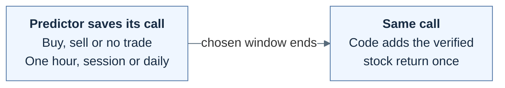
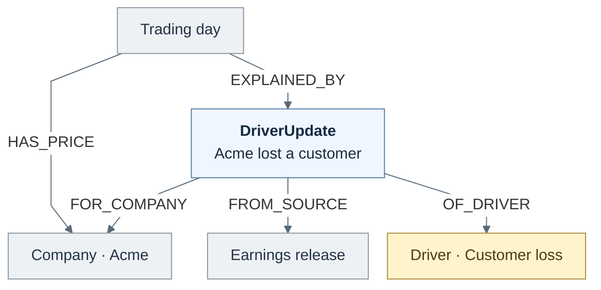
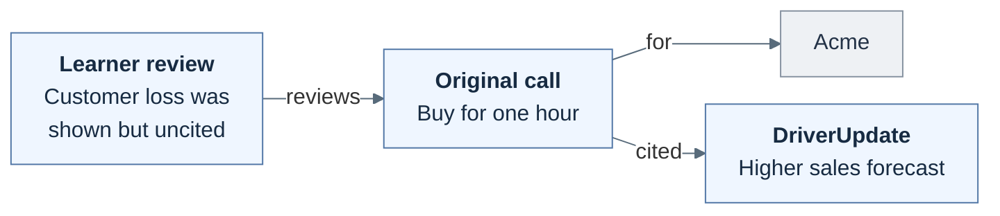
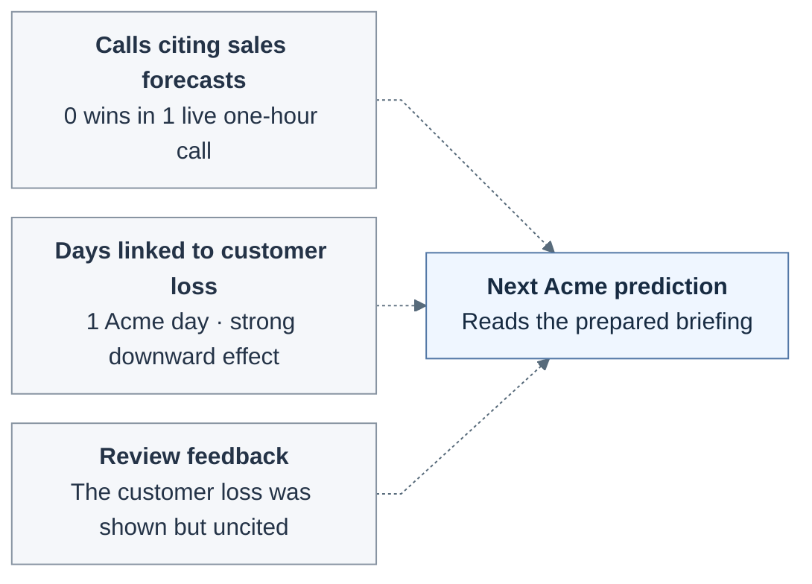

# Predictions and Driver histories

Keep Predictor calls, results, Learner reviews and their contents only in Neo4j. For both workflows, the fields and formats, how much input, analysis and feedback to keep, and whether to save written lessons are tentative.

## The plan in pictures

[C · Reviewing a call](#picture-c--what-does-the-learner-save-about-a-call) · [D · Using the review next time](#picture-d--how-does-this-help-the-next-prediction)

### Picture A · How one prediction gets its result

Acme raises its sales forecast and reports a customer loss. The Predictor sees both and cites the forecast in a one-hour buy call. Verified prices of $100 at entry and $97 at the end give a stock return of **−3%**. The buy was wrong. [Grading](#grading)

### Picture B · What explains the whole trading day?

Suppose Acme fell 5% from close to close while the market was flat. The evidence supports a strong downward effect from the customer loss.

The price link holds Acme’s daily return. The explanation link records what the Learner judged pushed the stock that day. [Source and company links](EXPLAINED_BY.md#2-what-links-to-what) · [Business cause and offset links](DRIVER_RULES.md#picture-b--one-fact-and-its-record)

### Picture C · What does the Learner save about a call?

Every live call gets a review when its chosen window ends. A later review of this qualifying day can link back to the same call.

**Was the customer loss shown?** Here its update ID is in the saved input. Its exact supporting passage from the cited source version would also prove it was shown. Other findings are *public but absent*, *first public later*, or *unknown* when the evidence cannot tell. A review can cover several calls or a move with no call. [Review schedule](#learner-reviews)

### Picture D · How does this help the next prediction?

**What starts a call?** Earnings releases always do. The explanation for this qualifying daily drop puts customer loss on Acme’s watchlist. A new source version with another verified Acme customer-loss update then triggers a call. [Watchlist rules](#predictor)

**What can it learn from?** The dotted arrows show what code can include by the call’s information cutoff. The two histories are calculated separately for a company, industry or sector. Call results are counted by horizon, with live and replay kept separate. [History counts](#driver-histories) · [Cutoff rules](#input-cutoff)

Fields on the prediction, review and daily explanation

| Saved item | What it holds |
|---|---|
| Prediction | Company link, triggering source ID and version, live or replay, replay ID when applicable. Buy/sell/no trade, reason, model, input cutoff, save time, chosen hour/session/day and fixed end time. IDs of all updates shown, links to verified cited updates, and the verified stock return once available. A full input copy retrievable by fingerprint is tentative. |
| Learner review | Company, event or price windows covered, feedback, links to any calls reviewed, save time, evidence cutoff and replay ID when applicable. |
| Daily `EXPLAINED_BY` link | Affected company ID, reason, direction, strength, confidence, producer, live/backfill mode, save time and Learner evidence cutoff. [Explanation fields](EXPLAINED_BY.md#5-what-each-explanation-stores) |

## Qualifying move

A move qualifies when the absolute difference between stock and SPY (S&P 500) returns over the same hourly, session or daily window is **at least 2.2 percentage points**. Use this single threshold for all move checks. Hourly and session checks require a timed source event. Without one, check the daily close-to-close move. Verify prices and windows before using returns for triggers or grading. [Driver rule 10.1](DRIVER_RULES.md) · [Return checks](EXPLAINED_BY.md#8-return-measurements--open-checks-for-the-next-bot)

## Predictor

Make a paper call at each earnings release. Any other newly public source version, including the earnings transcript, triggers a separate call if it yields a verified DriverUpdate matching the company’s watchlist, even while an earlier call is open. Holding, exiting or adding to a position is a separate trading decision.

Derive the watchlist from available `EXPLAINED_BY` links. Include a Driver while at least one link connects its update to that company’s qualifying close-to-close move. An intraday crossing can trigger research. Each link records a judgment about the day.

- **Company-specific update.** Match its Driver and subject company to those of an update that explained the watching company’s move.
- **Shared update.** Match only shared entries for the same Driver. The source reader determines scope from the cited passage. A market-wide change triggers all matching watchers. An event limited to particular companies triggers only matching watchers the passage identifies as parties. If scope is unclear, keep the update without triggering a call.

Seal one graph record per company, triggering source ID and version, separately for live calls and for each replay. Multiple qualifying updates in one version and retries reuse that call. Separate publications may each qualify even when they repeat the same claim.

- Show each supplied DriverUpdate’s ID and keep it in the call’s input record. The Predictor cites the updates it relied on by ID. Code verifies each was shown and links the call to those updates and its company. A full immutable input copy retrievable by the call’s fingerprint is tentative.
- Record the directional call (buy, sell or no trade), reason, model and mode from the producing run (live or replay).
- Record the input cutoff, code-stamped save time, chosen horizon and fixed end time. The replay input cutoff is the simulated decision time.

### Input cutoff

In live runs and replays, the Predictor sees only the context supplied by code and has no direct database access. Expect mainly DriverUpdates and their quotes. The exact contents, including whether to supply original documents, are tentative.

Code applies the cutoff when selecting evidence, watchlist entries and histories. Require proof the cited source version was public before the cutoff. A prior result requires a completed window and verified prices available by then. [Driver rule 7.6](DRIVER_RULES.md)

Each review and daily explanation keeps its actual save time (`created`) and the Learner’s evidence cutoff. Use either only when it is available in the call’s history and its evidence cutoff is at or before the call’s input cutoff.

- **Live calls.** Prior calls, results, reviews and [explanations](EXPLAINED_BY.md#5-what-each-explanation-stores) are eligible if available in shared history when input closes. Live runs and historical backfills designated at launch build that history. Backfill calls keep replay mode.
- **Replay calls.** Eligible history includes shared history available at the simulated cutoff plus earlier completed steps from the same replay. Keep the replay ID on calls and reviews across retries. Outside shared history, save judgments and withdrawals in the review under the existing explanation key. The replay’s latest eligible judgment or withdrawal for each key takes precedence in that replay.

## Grading

Use the live save time or replay decision time to fix the end of the Predictor’s chosen hour, session or day when the call is saved. Enter at the first verified tradable price **after** that starting time. If entry is at or beyond the end, or either price is missing or unverified, leave the call ungraded. [Existing window calculations](../../../../eventReturns/EventReturnsManager.py)

Code saves the stock return once on the original call as `100 × (end price − entry price) / entry price`, rounded to two decimals. A buy wins if the saved return is positive, a sell if it is negative. Zero wins neither. For no trade, record the move skipped without a directional grade. Only live calls measure paper-trading performance.

## Learner reviews

Save one record per completed review with its feedback, company and the event or price windows covered. Link every call reviewed, if any. Retries reuse the record.

| When | What to review |
|---|---|
| Every live call’s horizon ends | Briefly review the result, reason and saved input, including for no trade. A deeper review due then for the same event covers both. |
| At the close of the first trading day after the qualifying window’s end date (Eastern time) | Investigate the move, even without a prediction or news. This close is the replay cutoff. |
| Earnings preview at the [evening calendar scan](../../../../k8s/processing/trade-ready-scanner.yaml) on the trading day before scheduled earnings | Use the release date known then. Revisit each qualifying move once at the first preview **after its initial review**, explained or unexplained. |
| After every earnings event | Live, review the results and transcript when the transcript arrives. In replay, stop just before the next earnings release or at the replay end, whichever comes first. If the release date was unknown at preview time, revisit moves still due a second look after their first. New evidence may correct an earlier explanation. |

The Learner may search the database directly, using the existing views for DriverUpdates (rule 7.11). Limit its reads to evidence available at the live review’s start or by its replay cutoff. Process later disclosures on arrival. They can inform subsequent calls without reopening an old move. Discoveries from either agent follow the [normal DriverUpdate workflow](DRIVER_RULES.md).

Save supported daily explanations in the [run’s history](#input-cutoff). Update changed judgments or explicitly withdraw those the evidence no longer supports. Omission alone leaves them in place.

For each reviewed call, classify each explaining update it did not cite. Count it as “shown but uncited” (possible oversight) if the saved input contains its ID or its exact supporting passage from the cited source version. Record “public but absent” (input gap) only if the cutoff and saved input establish both. Use “first public later” when proven and “unknown” when the record cannot tell.

## Driver histories

Calculate both histories on read for a company, its industry or its sector, each with its own count.

- **Call outcomes.** Count each graded buy or sell that relied on the Driver once. Show wins and total by horizon, with live and replay separate. Overlapping calls on one company can reflect the same stock move.
- **Daily explanations.** Count distinct affected company-days linked to the Driver. Keep each judgment’s direction and strength. An absent link leaves the effect unknown.
