> Working copy of [`DRIVER_RULES_Categorized.md`](DRIVER_RULES_Categorized.md) (older, itself built from [`DRIVER_RULES_Simplified.md`](Archive/DRIVER_RULES_Simplified.md)), copied 2026-11-16. Rule numbers are unchanged across all three. The two may diverge; this one is kept up to date.

**Target state.** One build covers everything in this rulebook except what the owner excludes or keeps off. See “Target scope” in the [Overview](#overview). Honor all proof gates and the limits in 9.3, 9.4, 9.6 and 9.9.

This file wins over every older document. For fact subjects, News and daily explanations, use EXPLAINED_BY.md/NewsMultipleSymbols.md; FINAL_DESIGN.md is unmaintained background for this revision. For other unresolved conflicts between older documents, use [`Archive/DRIVER_RULES.md`](Archive/DRIVER_RULES.md) Part C4, “Which source wins”.

### Final check before building

  1. 🟡 EXPLAINED_BY: current design in [EXPLAINED_BY.md](DRIVER_Predict_Explain_Learn/References/EXPLAINED_BY.md), also drawing on [NewsMultipleSymbols.md](DRIVER_Predict_Explain_Learn/References/NewsMultipleSymbols.md) (added when news restarts, via Massive). Resolved: daily explanations start from Date, with the affected company on the EXPLAINED_BY link; one fact may explain several companies/days (A2); no DailyCompanyMoveEvent. Open: final owner check (at S5), remaining design choices and [return checks](DriverWorkflow/DriverDataAndCodeIssues.md#return-measurements).
  2. 🟡 Test synonym checking and grouping before enabling `SAME_AS` (5.6, 7.1).

# Driver rules

**Owner-approved edits:** Oct 1 (evidence, reads, `source_location`), Oct 2 (expectation type, cause links, quotes, currencies), Nov 14 (synced with EXPLAINED_BY and News). Rule-by-rule detail: git history.

**Index** (read in this order): [S1 ground rules](#s1--ground-rules-read-first) — [Driver](#driver): [1](#1--driver-record--relationships) · [2a](#2a--fact-type) · [2b](#2b--name) · [2c](#2c--which-name--family) · [3](#3--creating-a-driver) — [DriverUpdate](#driverupdate): [U1a](#u1a--record--evidence) · [U1b](#u1b--period) · [U1c](#u1c--slices--measurement-tags) · [U1d](#u1d--states--amounts) · [U2a](#u2a--saving) · [U2b](#u2b--links-to-filing-data) · [U2c](#u2c--reading--comparing) · [U3a](#u3a--forecasts) · [U3b](#u3b--surprises) — [System](#system): [S2](#s2--purpose-sources--companies) · [S3](#s3--processing-timing--retries) · [S4](#s4--ai-use--testing) · [S5](#s5--price-move-explanations) — [Overview](#overview)

**Overlaps to review** (both kept for now): 1.7 / 7.7 · 2.19 / 4.2 · 2.2 / 2.38 · 2.34 / 6.11 · 3.50 / 7.8 · 3.35 / 7.2 · 1.14 / 7.6.

## S1 · Ground rules (read first)

**Uncertain? Keep separate**

- 1.12 **The one law: when unsure, keep separate.** Merging different meanings does permanent damage: a merged forecast and result can never be untangled (bad trades forever). Keeping the same meaning separate only misses a valid comparison.
- 8.5 **Fail closed:** uncertain meaning is held, skipped or refused, never guessed into an accepted fact or identity. A model's confidence score is never permission to write or merge.
- 1.16 Missing links are safer than wrong links.

**Preserve saved Drivers and facts**

- 1.15 **History is add-only.** Never delete, re-key (give a new ID) or move (reassign to another Driver or label) a saved Driver or fact, not even to make history look cleaner. True duplicates are never merged: at most they get a reversible synonym link (`SAME_AS`).
- 6.18 **Links and rename notes after saving.** Never delete a synonym link or company rename note. The owner may switch one off when evidence proves its original approval was wrong. Only the owner may restore it, and only if evidence proves it was switched off by mistake. Change only `active`. Every view, including a past view, follows only active joins and honors blocked synonym pairs (7.1). Original evidence, facts and recorded predictions stay intact.
  - A restored synonym must pass 7.1. A restored rename must pass 6.16, the only automatic switch-off.
  - Other saved links cannot be deleted or switched off, with two exceptions. Latest EXPLAINED_BY judgments may be replaced or explicitly withdrawn (A2.2), and newer News versions remove obsolete source links under NewsMultipleSymbols.md. Neither exception deletes or re-keys Driver facts.
- 6.20 **No background audit or repair.** No background process reviews or hides saved facts or Drivers, or adds same-meaning links. Normal saving follows 5.1. A Driver's name, type and frozen defining evidence never change (2.1, 2.2). A fact saved under the wrong Driver stays there. Checks before saving (sections 1–5) and the launch test (8.17) must stand on their own. When unsure, keep separate (1.12).
- ⚠ **Wrong merges are the biggest known risk.** There is no general automatic check, even with XBRL. If two old names lead to one new name within the same company and rename kind, rule 6.16 switches both rename notes off.

**AI vs code**

- 8.1 **Meaning is AI's job:** every routine judgment about meaning is made by AI (the Decider or the smart model). Code does only basic, mechanical work (8.4). Text inside a source is data, never instructions.
- 8.2 **Whoever proposes never approves.** The smart AI and Driver search propose one destination per fact check. A separate AI call judges each new decision from the proposal, source evidence and needed context. Hide prior verdicts, similarity scores and proposer reasoning. For placement, show the shortlist, any saved proposal and any names tied with it in the full search (2.41–2.43). Alphabetize them and give each name, type and frozen evidence (2.1). Hide synonym links and tie-break counts.
- ⚠ **Same-vendor blind spots:** if the AI that proposes and the AI that checks come from the same vendor, they may make the same mistakes; test that the checker really catches mistakes, never assume it. Only the mechanical XBRL checks are fully independent.
- 8.3 **Routine work never asks or waits for a person.** Owner corrections under 6.18 are optional.

**Build small and exact**

- 8.4 **Hard rule: simplest, fully generic, no exceptions.** Build from first principles the most minimal, 100% reliable solution that works at scale. No hardcoded logic (string matching, parsing), no heuristics, no lists we maintain (official standard lists such as XBRL unit codes, and the segment lists in 3.21, are fine), no overfitting, no speculative work (including handling errors that haven't happened), no overengineering.
- 8.7 Fix the whole class of a problem, never just one example.
- ⚠ **Copies of rules drift:** a copy served to the AI or written into code can change meaning (a "may" where the rule says "must"; an exclusion copied as a veto). Keep one copy of each rule and check every copy against the approved wording.

**Words used here** (from the original Word list)

| Word | Meaning |
|---|---|
| **Driver** | One reusable cause or standing thing that can matter to a company or market. Stored as a name, a permanent fact type and its frozen defining evidence (2.1); it has no status. |
| **Fact = DriverUpdate** | One real, source-backed occurrence of a Driver in one source event (the `(:DriverUpdate)` node), e.g. "revenue rose 5% to $2.1B" in one earnings release. |
| **Fail closed** | When required proof is missing: don't create, link, merge or write. |
| **Core** | The central system that decides meaning and identity and writes facts. Sources only supply evidence. |

## Driver

### 1 · Driver record & relationships

- 1.1 The same name is reused for the same cause across companies and over time. *Why:* then scattered mentions line up into one clean history per cause, and that history is what gets acted on.
- 1.2 A Driver (the name) is separate from its facts. Each fact is added under an existing or new Driver and tagged with its source and event. A Driver can have facts from many events; one event can have facts for many Drivers.

**The Driver system, in pictures**

These show the target design; the opening scope and proof gates apply. Full explanations stay in the numbered rules below.

**Key:** `(:Label)` = node; grey = existing, blue = planned record, yellow = Driver. Solid named arrows are stored links; dotted arrows are worked out. Process/time arrows show steps. `1` = exactly one; `0..1` = optional; `0..many` = any number. † marks an older design/code name, not independent approval.

#### Picture A · From source to saved facts

Process view. Full rules: [creation](#3--creating-a-driver), [saving](#u2a--saving), [processing](#s3--processing-timing--retries), [testing](#s4--ai-use--testing).

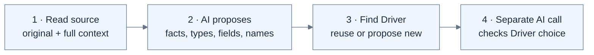

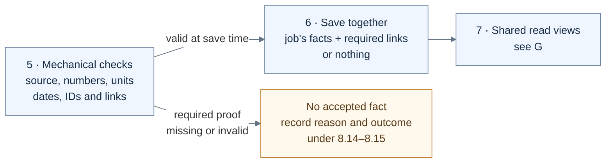

#### Picture B · One fact and its record

Company-specific facts need one proven subject; genuinely shared facts have none. The subject and affected stock may differ. [Fields and links](#u1a--record--evidence).

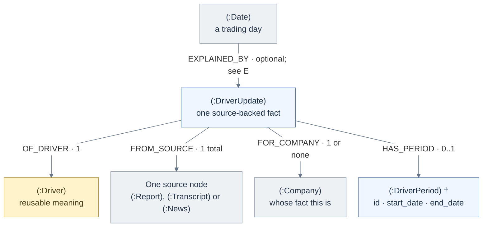

Stated business causes/offsets are separate from stock-price explanations (3.53).

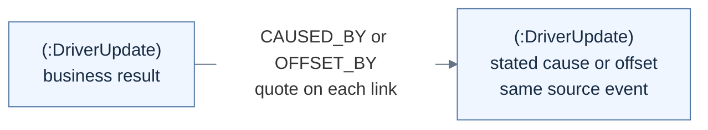

Legacy roles: `(:Guidance)` → guidance-type Driver; `(:GuidanceUpdate)` → DriverUpdate; `(:GuidancePeriod)` → DriverPeriod. These are successor roles only: old `UPDATES` links stay separate, with no conversion, replay, bridge or fallback (8.11).

#### Picture C · Types, families and renames

Same company, slice and period. The forecast is earlier; result and surprise share a later source. The surprise comparison must be stated there (4.14–4.16).

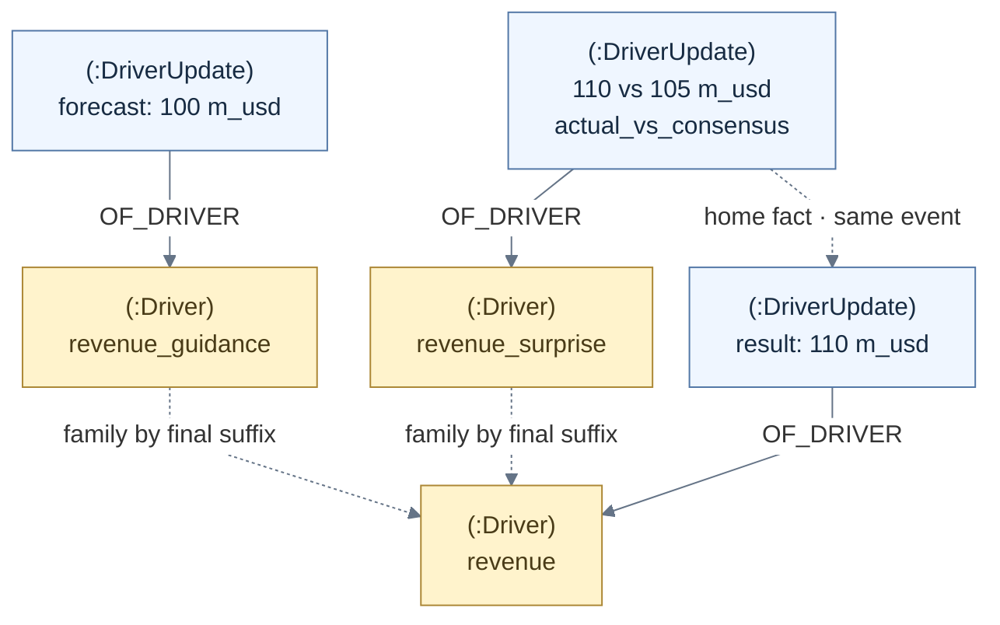

Family comes from the name. SAME_AS means equal meaning. A ContinuationClaim records one company's declared rename (1.19, 6.13–6.18).

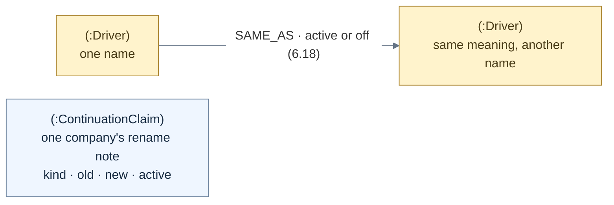

A rename note stores the checked company and source IDs as fields (6.13).

#### Picture D · Sources, companies and market groups

These are source links, not fact ownership or proof of a price effect (3.9, A2). Boxes show roles; reuse the same Company when roles coincide. Company carries `id`, `cik`, `ticker` and fiscal year-end; `Report.isAmendment` marks amendments.

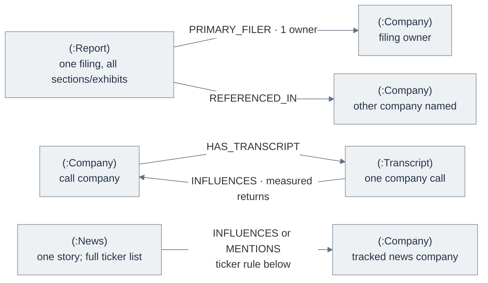

News: count distinct tickers before filtering. One total, tracked → INFLUENCES; 2+ total with any tracked → MENTIONS per tracked company. None tracked → skip new ordinary feed stories; save selected original research. [Full News rules](DRIVER_Predict_Explain_Learn/References/NewsMultipleSymbols.md).

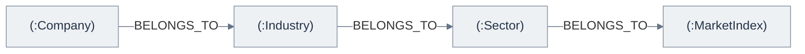

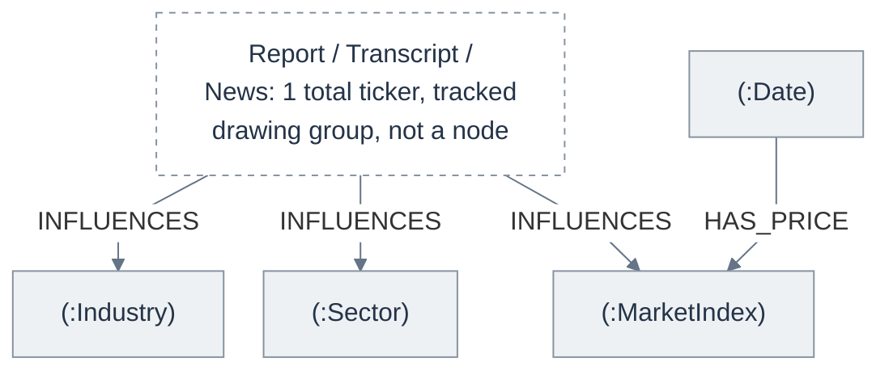

Sector/industry prices are optional context. NEXT means next calendar day. Report `created` is public time; Transcript `conference_datetime` is call start, not full-transcript availability. Publication-time evidence follows 7.6.

#### Picture E · A fact explains a company's daily move

Source owner, fact subject and affected company may differ; the affected company need not be named. [EXPLAINED_BY §6](DRIVER_Predict_Explain_Learn/References/EXPLAINED_BY.md#6-source-and-company-examples-simple-retrieval).

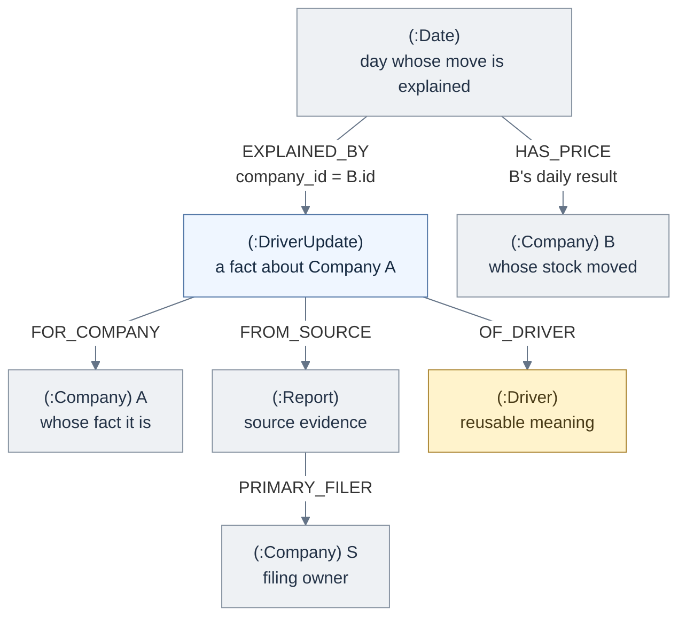

**Time example:**

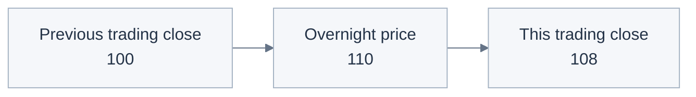

Using split-adjusted closes, daily return is **+8%** (100 → 108), with no added overnight return. Display times in America/Toronto (EST/EDT). Full [daily explanation rules](#s5--price-move-explanations).

#### Picture F · Proof from tagged filing data

Concept/Member links are optional. The filing’s `(:Fact)` and our `(:DriverUpdate)` are different nodes (3.11, 6.1–6.10).

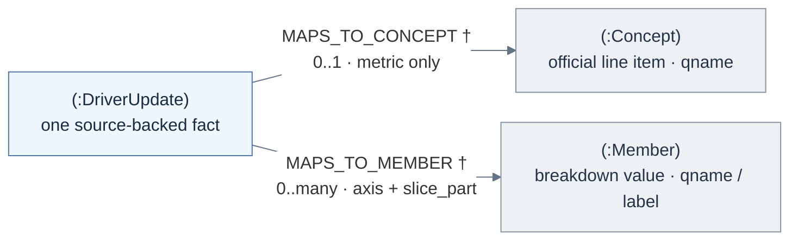

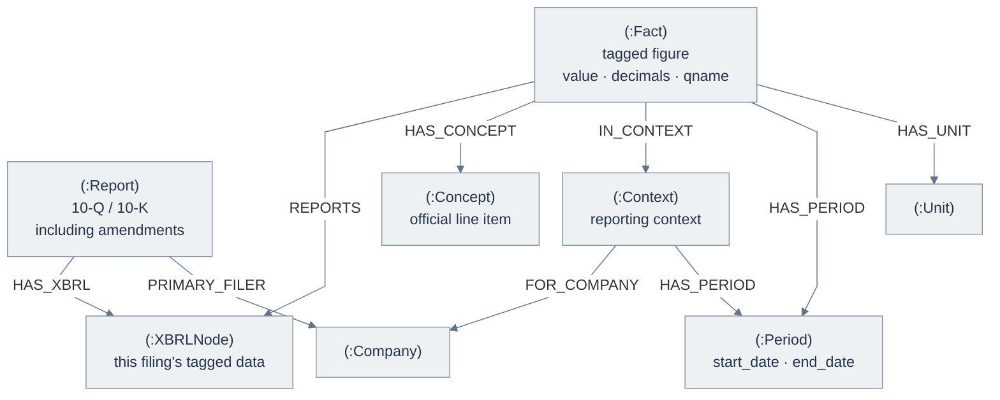

Member proof needs the complete Context’s axis/member pairs, including checked “none”; sparse FACT_DIMENSION edges are insufficient (6.9–6.10).

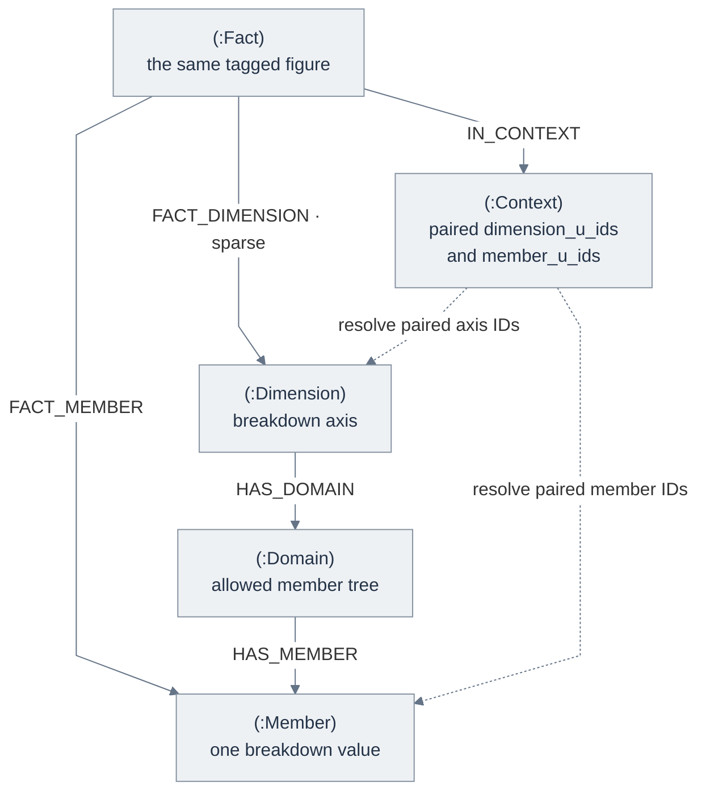

Other paths include deeper HAS_MEMBER/PARENT_OF and direct Dimension-to-Member links; members may span axes. Bare qnames are not unique across filing namespaces. The matcher accounts for XBRL’s exclusive-end dates.

[Filing links and Part A1](#u2b--links-to-filing-data). Its required subtotal check concerns existing CALCULATION_EDGE structure, not a Driver link. Part A1 specifies the evidence for a tagged figure or precision upgrade.

#### Picture G · Read history without rewriting it

Process view: reading changes the display, never stored facts. Full [read rules](#u2c--reading--comparing), [period rules](#u1b--period) and [past-information limits](#s3--processing-timing--retries).

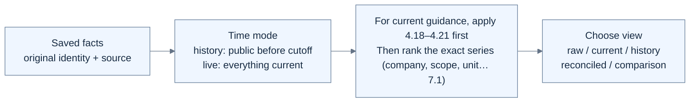

**Stored relationships and rename note** (the fact fields are in 3.3)

| Relationship or node | Endpoints or scope | How many | Status | Rules |
|---|---|---|---|---|
| `OF_DRIVER` | (:DriverUpdate) → (:Driver) | exactly 1 | new | 3.9 |
| `FROM_SOURCE` | (:DriverUpdate) → one of (:Report), (:Transcript), (:News) | exactly 1 in total; `source_type` must match the node's kind | new | 3.9, 3.3, A2.8 |
| `HAS_PERIOD` | (:DriverUpdate) → (:DriverPeriod) | 0 or 1; the same period id also sits in `fact_scope` | new | 3.10, 3.36, 3.45, 3.46 |
| `MAPS_TO_MEMBER` (slice_part, axis) | (:DriverUpdate) → (:Member) | 0 to many, any fact type | new | 3.11, 6.9, 6.10 |
| `MAPS_TO_CONCEPT` † | (:DriverUpdate) → (:Concept) | 0 or 1, metric facts only, = `xbrl_qname` | new, not built yet | 3.11, 6.1–6.8 |
| `CAUSED_BY` · `OFFSET_BY` (quote) | (:DriverUpdate) → (:DriverUpdate): result → what drove it (or a stated share of it) · what pushed against it | 0 to many; both facts from the same source event | new | 3.53 |
| `SAME_AS` (active) | (:Driver) → (:Driver) | at most 1 per pair, regardless of order | test before use | 1.19, 5.6, 6.18, 7.1, 9.9 |
| `(:ContinuationClaim)` (kind, old, new, company_id, source_event_id, evidence_quote, declared_at, created, active) | one company's Driver name, slice label or measurement tag | one node per approved rename | this build | 6.13–6.18, 9.10 |
| `EXPLAINED_BY` (company_id, reason, stock_impact, weightage, confidence, llm_producer, produced_mode, created) | (:Date) → (:DriverUpdate) | 1 latest judgment per Date + affected Company ID + DriverUpdate ID + producer | planned, not built yet | 3.12, A2.1–A2.8 |
| `FOR_COMPANY` | (:DriverUpdate) → (:Company) | exactly 1 for a company-specific fact; 0 for a shared fact | planned, not built yet | 3.9 |
| `PRIMARY_FILER` | (:Report) → (:Company) | exactly 1 owner; the price returns sit on it (daily_stock, session_stock …) | exists | 3.9, 1.14, A2.5 |
| `REFERENCED_IN` | (:Report) → (:Company) | other companies the filing names, not owners; same return fields | exists | 3.9 |
| `HAS_TRANSCRIPT` | (:Company) → (:Transcript) |  | exists | 3.9 |
| `INFLUENCES` | (:Transcript), (:News) → (:Company); all three sources → (:Industry), (:Sector), (:MarketIndex) | price returns (daily_stock …); for news the company link is a tag, not an owner (3.9); News uses INFLUENCES only for one distinct total ticker, tracked; 2+ use MENTIONS to tracked companies (9.5) | exists | 1.14, A2.5, 3.9, 9.5 |
| `MENTIONS` | (:News) → each tracked (:Company) | 2+ distinct total tickers with at least 1 tracked; per-company stock/sector/industry/market returns, no direct sector/industry/market links | planned, not built yet | 9.5 |
| `BELONGS_TO` | (:Company) → (:Industry) → (:Sector) → (:MarketIndex) |  | exists | 1.20, 2.42 |
| `HAS_PRICE` (open, close, daily_return …) | (:Date) → (:Company), (:MarketIndex) | one per trading day; (:Date) → `NEXT` → (:Date) | exists | A2.7 |
| `HAS_XBRL` · `REPORTS` · `HAS_CONCEPT` · `FACT_MEMBER` · `FACT_DIMENSION` · `HAS_PERIOD` · `IN_CONTEXT` · `HAS_UNIT` · `FOR_COMPANY` | the tagged-data structure in picture C |  | exists | 6.7, 6.9, 3.16 |

**No stored relationship**

| Relation | Between | How | Rules |
|---|---|---|---|
| family | (:Driver) ⇢ (:Driver) | read from the name | 1.18, 2.26 |
| birth fact | (:Driver) ⇢ its first (:DriverUpdate) | id, quote and needed context stored as properties on the Driver | 2.1, 2.35 |
| home fact | a surprise fact ⇢ its metric or confirmed guidance fact, same event | same result or forecast, including distinguishing conditions, subject, family, period and kind, slice, measurement and stated value/unit | 4.14 |
| inherited line item | a guidance or surprise fact ⇢ its base metric's (:Concept) | worked out when read | 6.2 |
| slice values offered | the company's earlier (:Member)s plus values already used ⇢ the reader's list | cut at public time | 3.17, 3.19 |
| 8-K pairing | an earnings 8-K ⇢ its 10-Q or 10-K | routing only | 3.44 |
| read-time grouping | two labels with the same axis and member, all their linked facts agreeing ⇢ one display group | within one company and slice part | 7.9 |
| never | action fact → line item · old Guidance data → Driver facts · a day's move as a source |  | 3.9, 6.2, 8.11, A2.8 |
`SAME_AS` = same meaning (5.6) · `ContinuationClaim` = a company's dated rename note (6.13) · Family: read from the name (`revenue_guidance` belongs to `revenue`), not stored.

- 1.19 A reversible synonym link records the same meaning (5.6, 6.18). Family = related flavors, read from the name (1.18). Never use one in place of the other; passing the family check (2.26) never creates or implies a synonym link. The head of a group joined under 7.1 is for display only. Use the earliest birth-fact `created`, then alphabetical Driver name (2.1, 3.3). Example chain: `net_sales_guidance` → (same family, by name) → `net_sales` → synonym → `revenue`. A missing synonym link costs a missed comparison, never a wrong merged number.

- 2.1 A Driver = name + permanent `fact_type` + its defining evidence, frozen when the Driver is saved: the ID of its birth fact (the fact it was saved with), that fact's exact quote, and only the source context needed to understand it (e.g. the table heading, or the question an answer replies to); never an AI-written summary. The frozen evidence is kept on the Driver itself and never changes, even if the birth fact is re-written later (5.5); nothing depends on finding the quote in the source again. Links are separate, reversible records; the family is read from the name (1.18). Think of an index card: one card per meaning, and each fact is an entry on that card. Every identity check compares against the frozen evidence. *Why:* otherwise a Driver's meaning could drift, one small approval at a time.
- 2.2 **Drivers have no status.** Once saved, a Driver's record, including its frozen evidence (2.1), never changes.

- 2.38 The fact type is set once, at creation. A Driver without a type can't accept facts. A Driver that has facts is never re-typed. No tool may rename, delete, re-type, re-key or orphan a Driver that has facts.

- 5.6 **Synonyms.** Enable only after the checker and grouping pass their tests (7.1, 8.13). Only the normal fact checker may flag two shown, saved Drivers whose frozen definitions suggest the same meaning, whatever the fact verdict. Skip the pair proposal and check if active links already connect the names. An indirect join supplies no direct verdict. Reuse the pair's recorded verdict (2.46–2.47). A separate call checks each eligible new pair using only the two names, types and frozen evidence (2.1, 2.40, 9.9). On direct approval, save one link with `active=true` if 7.1 allows it. Fact placement ignores links and never waits for this check. No model may delete, re-key or move facts or bypass approval.
  - Hide join status from the checker (8.2). If two frozen definitions already in an ordinary check clearly mean different things, its answer names both Drivers, cites both definitions and explains the difference. After the verdict, code logs those names, citations and reason on the existing run-log item only for a direct or indirect synonym join already known to the run (8.12, 10.2). Never store this warning as a pair verdict or refusal. A failed fact match alone is insufficient. Warnings may repeat. They require no extra lookup or AI call, change no join and never hold a fact.

<details>
<summary>Folded: Company-declared renames (9.10)</summary>

- 6.13 Save each approved company rename as one `(:ContinuationClaim)` node. Set `kind` to `driver_name`, `slice_label` or `measurement_tag`. Use the declaring company's `Company.id` for `company_id` and the cited source's `id` for `source_event_id`. Refuse the note if either record is missing. *Why:* the note can join histories even for the ~57% of facts without an XBRL member link.
- 6.14 Only new proposals go to the independent checker (8.2). Keep the company's exact words in `evidence_quote`, with enough context to prove both exact names and that composition and measurement method stayed the same. Refuse insufficient evidence or a recast, recomposition or reclassification of the item being renamed.
  - For `old` and `new`, use the unique `Driver.name` (2.35), whole slice `kind:value` (3.20), or exact stored measurement tag (3.24–3.25). The checker must find both names on this company's accepted facts, including this source's, and identify exactly what was renamed. An unused name alone means skip and log, with no note, hold or refusal. Judge the declaration if a later permitted read finds it with both names in use (9.10). Reuse refusals on unchanged evidence (2.46–2.47).
- 6.15 Set `declared_at` to the cited source's proven public time (7.6), regardless of the rename's effective date. Code sets `created` to the first save time and `active=true` on first approval. Thereafter change `active` only under 6.18. A note affects only its company's requested joined history (7.10) and never spreads to a Driver's family (1.18).
- 6.16 Within one company and kind, allow at most one active note per old name. Refuse a competing target or a loop. If two old names lead to one new name, switch both notes off. A changed division tag alone never changes `active`.
- 6.17 Enforce database uniqueness on `(company_id, kind, old, new)`. A repeat leaves the entire note unchanged, even if published earlier. A rename proposal never counts as a fact. Its refusal never invalidates other facts from the same source.

</details>

- 9.6 **No financial-classification field** on Drivers for now; facts carry exact data instead (company-specific XBRL links, money units). Revisit only if a named user and a testable definition exist.

- 9.9 **No instant linking.** A newly created Driver is never linked on the spot as a synonym of an existing one. Any future exception for instant linking needs strong independent confirmation and its own safety design.
- 9.10 **Company-declared renames.** Flag explicit company renames during the ordinary filing read. Save each independently approved rename once (6.13–6.17). Join histories only on request (7.10). Keep every source document (news edits follow 7.6) and original label (3.22). Past filings read under 8.16 can supply rename evidence without rewriting facts.

- 10.2 **Wrong saved name or fact type.** Earlier facts stay visible under the normal read rules (2.38, 6.20, 7.11). If the saved Driver’s own evidence clearly contradicts its name or type, refuse that match. Record its unique name and cite the contradicting evidence in the run log (8.12). Handle the incoming fact under 2.47.

**Words used here** (from the original Word list)

| Word | Meaning |
|---|---|
| **Synonym link** (`SAME_AS`) | A reversible link saying two Driver names mean the same thing (5.6, 6.18). |
| **Birth fact** | The fact a Driver was saved with. Its ID, its exact quote and the context needed to read it are frozen on the Driver and set what it means (2.1). |
| **Link** | A stored connection, e.g. a synonym link between two Drivers or a fact's link to its official filing line item. Rule 6.18 governs links after saving. |

### 2 · Naming rules & fact types

#### 2a · Fact type

| Type | Means | Examples from the sources |
|---|---|---|
| `metric` | A standing level or condition you can read again later: a number, or a state like sentiment or a policy in force | `revenue`, `oil_price_per_barrel`, `litigation` |
| `guidance` | A forecast of a standing measure or condition attributed to the company (4.9) | `revenue_guidance`, `bookings_guidance` |
| `surprise` | A company result compared with the consensus or the company's confirmed earlier forecast, or confirmed company guidance compared with the consensus | `earnings_per_share_surprise` |
| `action_event` | A discrete action or event, its reported stage, or a company prediction under 10.5 | `asset_impairment`, `buyback`, `dividend` |
| `expectation` | An outsider’s own forecast of a measure or event, including reported consensus | `revenue_expectation` |

- 1.5 **The persistence test and the locked definitions.** The persistence test decides metric versus action: between two events, is there a standing level you could read again? Yes → `metric`; no → `action_event`. An admitted suffix (2.19) overrides it. The plain version of the definitions is the table above and 1.6–1.8; the exact locked wording is just below (1.9; `fact_scope` is the fact's scope, 3.2).

<details><summary>The exact locked wording (the meaning authority)</summary>

> **metric** = any standing variable readable again over time (number/cost/price/rate/count/ratio OR a qualitative condition: weather, sentiment, policy-in-force, labor, brand) — NOT only a number · **guidance** = a forward outlook/target/forecast of a standing measure or condition attributed to the company (4.9) · **surprise** = a company value — DELIVERED (an actual) OR PROMISED (confirmed company guidance) — vs a CROSS-PARTY EXPECTATION (analyst consensus/Street, or for an actual the company's confirmed prior guide), NOT vs a prior-period actual (that's a metric change) and NOT a new-guide-vs-own-prior-guide revision (that's a guidance movement); the 3 types (`actual_vs_consensus` / `actual_vs_guidance` / `guidance_vs_consensus`) live in the `surprise=` fact_scope slot (OD-21) · **action_event** = a discrete action or event (decision, transaction, incident, approval, one-off charge), its reported stage, or the company’s prediction of another party’s action (10.5) · **expectation** = an outside forecaster’s own forecast of a measure or event, including reported consensus (9.11).

> Persistence test: between two events, is there a standing level/severity you could re-read? Yes → metric · No → action_event. An admitted suffix overrides. Company outlook for a standing measure/condition → guidance. Company’s own stated action plan → `action_event/announced`. Company prediction of another party’s action → `action_event/forecast`. Outsider’s own forecast → expectation. A forecast never becomes a metric state. A condition alone establishes no separate prediction. Dual framing allowed (`dividend` = action_event vs `dividend_per_share` = metric). Bare-root defaults: litigation/convertible_notes/dividend_policy/restructuring_costs → metric; corporate_restructuring/asset_impairment → action_event.

</details>

- 1.6 Forecast words alone never decide the type (1.5).
- 1.7 Both framings of one topic can exist as different Drivers: `dividend` (action_event) and `dividend_per_share` (metric).
- 1.8 Fixed defaults for bare names: `litigation`, `convertible_notes`, `dividend_policy`, `restructuring_costs` → metric; `corporate_restructuring`, `asset_impairment` → action_event.
- 1.9 The quoted text is the meaning authority. A restatement (like the plain version above) may change only labels and typography, never meaning, and adds no clause or example. *Why:* an added clause was tested and made results worse.
- 1.10 *Why the original four:* they were checked against all 1,282 names from the catalog work, and none fit no type.
- 1.22 Outside forecasts use `expectation` (9.11). A stated surprise against the consensus stays a `surprise` fact (4.1).
- 1.23 **Keep apart:** a one-time event vs a standing level (a period total, an ongoing exposure or a policy in force is a metric; a lawsuit step or a policy change is an action, 7.7) · a planned act vs a forecast level · a predicted miss vs an actual one (4.3). An unclear type follows 2.30: in live use the fact is skipped and counted.
- 10.5 **Company prediction of another party’s action** (e.g. “we expect FDA approval in Q3”). Use `action_event/forecast` only if the source identifies the action and shows the company made or clearly adopted the prediction as its own. Skip and log speculation about management’s view alone. Unconfirmed reports of the action’s stage follow 3.8. Quote the speaker, predicted outcome, negation, conditions and timing. Use only a source-proven real predicted window as the period. Vague timing stays in the quote. Resolve ambiguous dates under 3.42. A predicted window supplies no occurrence date.
  - Keep predictions separate from reported stages when combining, saving and selecting the current reported stage, regardless of arrival order or source rank. Company or Driver alone cannot identify the same action. Changing, negating or withdrawing a prediction changes only the forecast claim; it does not establish that the underlying action was canceled, failed, completed or otherwise changed stage. Such a stage needs its own evidence. Keep independently supported stages. Later outcomes never rewrite predictions.

- 2.19 A final `_guidance`, `_surprise` or `_expectation` stays in the name and fixes the permanent fact type. One surprise Driver holds all three kinds of surprise comparison (4.2). Measure forecasts and surprises belong to their base metric’s family by name alone (1.18). An event expectation may use the action’s name before the suffix (2.23); it proves no event. Only a final suffix counts, and it is stripped only once. *Why:* a forecast or surprise is a different claim and gets its own Driver.

- 2.22 Strip exactly one final suffix (`bookings_guidance` → `bookings`). A stacked suffix (`revenue_guidance_surprise`) is invalid. A suffix in the middle (`fda_guidance_issuance`) doesn't count.
- 2.23 For `_guidance` and `_surprise`, admit the name only if the rest is a standing metric or condition whose level, state or severity can be read again over time, **and** the source is forecasting it (`_guidance`) or comparing it with expectations (`_surprise`). Any doubt → don't admit. This admits `bookings_guidance` and rejects names like `fda_guidance` or `buyback_guidance`, unless the rest truly is the guided metric. For `_expectation`, the source must establish an outside forecast of the specific base measure or event (9.11).
- 2.24 If it's not admitted, rename it only to a specific, source-grounded name without the suffix (never a broad bucket like `regulatory_guidance_update`), through the normal duplicate checks. If no safe rename exists, skip it and record why.
- 2.25 An admission decision, once made, is reused; a later refresh never re-decides it.

- 2.27 Fixed rules come first and can't be overruled: the suffix rules (2.22–2.24) and the fixed defaults in 1.8.
- 2.28 A bare name judged to be `action_event` is typed action, the safe direction.
- 2.29 A bare name judged to be guidance, surprise or expectation is a naming mistake, never a type. It is renamed with the suffix (2.22–2.24), or the item is skipped.
- 2.30 **A bare name judged to be a metric is typed metric only if the evidence shows the name itself is a standing level, value, condition or severity that can be read again over time, and not mainly a one-time action, decision, event or plan, with the exact evidence phrase quoted.**
  - Otherwise it is typed `action_event` with a visible, counted warning; the warning never blocks and never queues.
  - In live use, thin or unclear evidence is never defaulted to action: the item is skipped, unless a rule names an exact trigger that could change the result (8.15).
  - *Why the burden is on metric:* a false metric type is the error that spreads and merges permanently; a false action type fails closed and corrupts nothing.
- 2.31 Examples: `bookings` → metric if a standing-measure phrase is quoted · `buyback` → action (the metric form is a more specific name, like `buyback_authorization_remaining`) · `dividend` → action (metric form: `dividend_per_share`) · `restructuring` → action unless the evidence proves a standing cost or charge metric.

- 7.7 A standing per-unit policy level (e.g. a dividend per share) is a metric; a one-time decision to start, change or suspend the policy is an action (like 1.7).

**Words used here** (from the original Word list)

| Word | Meaning |
|---|---|
| **Fact type** | One of the five permanent types in 1.5. |
| **Bare name** | A Driver name with no type suffix (2.19). |

#### 2b · Name

- 2.3 The name holds the cause only; a stated per-unit denominator, a benchmark and a final type suffix may join it (2.15). State, direction, size, time, company, unit and quote live elsewhere. *Why:* a cause-only name is what lets the same cause recur and be tracked; anything extra breaks reuse.

- 2.5 The vocabulary is open and comes from the sources. *Why:* a closed vocabulary was tested and rejected; it turned away about 82% of useful names.
- 2.6 Use all the specificity the evidence supports. Never invent a broader class just to force reuse. *Why:* an earlier version coined generic names, collapsed three different demand stories into one, and failed a fresh test.
- 2.7 Format: lowercase plain letters (a–z), digits and underscores; starts with a letter; at least 2 characters; no trailing or doubled underscore. *Why:* one fixed form means the same cause always gives exactly the same text, so names group and compare reliably.
- 2.8 Word order: thing or actor (a commodity, a customer group, a policy body like the Fed or OPEC), then detail, then metric. Use singular count nouns, except (a) a standard plural term the concept is normally reported under (`earnings`, `bookings`, `sales`, `savings`, `futures`, `receivables`) and (b) a plural whose singular means something else (`product_returns`). The examples are not a list; this two-part test decides. A singular/plural pair naming the same concept is one Driver; if the meaning may differ (`booking` vs `bookings`), keep them separate. Never change a locked phrase (2.10). A stated exclusion or inclusion the name keeps (2.14, 2.17) is written `excluding_X` or `including_X`, right after what X is excluded from or included in: the metric, before any `per_X` (`cost_excluding_fuel_per_mile`); or the denominator, after it (`revenue_per_unit_excluding_self_installation`).
- 2.9 Use the familiar form only when the source doesn't state a meaningful sibling or benchmark. A stated specific instrument wins over the familiar broad name. *Why:* a name everyone already uses gets the most reuse.
- 2.10 Keep standard financial phrases whole (e.g. `ebitda`, `fcf`, `fed_rate`, `cogs`, `rpo`, `gross_margin`, `free_cash_flow`, `same_store_sales`); split up, they become names nobody reuses. A loss, deficit or negative margin is a negative value of the signed metric (`net_income`, `operating_margin`, `earnings_per_share`…), never a separate "loss" Driver. In general, name the signed measure, never one sign of it: an income-tax *benefit* is a negative value of the income-tax expense Driver (3.34).
- 2.11 One name carries one cause. Split independent causes. Keep names short and noun-like.
- 2.12 The company's own measured segment, product, geography, customer group, sales channel or owned stake goes in the slice, not the name. *Why:* facts are already grouped by slice and period when read; a company part in the name would fragment the history.
- 2.13 **The role test.** First ignore generic direction and effect words. Then sort what's left:
  - the company's own measured part → slice;
  - an outside actor, object, platform, policy, event or product that causes the outcome → stays in the name;
  - an unclear role, or a vague leftover → also stays in the name.

  A customer is a slice only when it is the company's own customer population. There is no vendor slice. *Why:* treating an unclear outside cause as a slice can merge two different causes; keeping it in the name may over-split and miss valid groupings.
- 2.14 **Portions.** Population words like `current`, `funded` or `fee_earning` stay in the name and make a different Driver from the bare one.
  - For company-specific metrics, guidance, surprises and measure expectations, only the true whole company has no slice (3.15).
  - Network-wide, systemwide, GMV (gross merchandise value) and other curated subsets are *not* the whole company, so they keep their qualifying word in the Driver name.
  - Leftovers the source states ("Other", "Corporate") may be company-specific slices.
  - Accounting eliminations and consolidation artifacts (bookkeeping lines that exist only to add the parts up to the company total) are neither names nor slices: drop and log the artifact and keep the real metric fact.
  - If a fact only *mentions* such an artifact as the reason for a change, it is written on the real metric it affects; if the fact is *about* the artifact itself, skip and log it. (Eliminations as slices: 3.21.)
  - *Why:* read as the whole company, "system-wide" figures would put a different population into the company's own series.
- 2.15 Only these may appear in a name: the cause, a stated per-unit denominator ("per X"), a benchmark (e.g. Brent in `brent_oil_price`), and a final type suffix (2.19). *Why:* a denominator or benchmark changes the actual number, so leaving it out would merge different numbers (`oil_price_per_barrel` vs `oil_price_per_tonne`).
- 2.16 **Per-unit names ("per X"):**

| Situation | Rule |
|---|---|
| The source states a business or physical "per X" | Keep it in the name (`oil_price_per_barrel`); never invent one |
| Two names with different denominators | Different Drivers, never synonyms |
| The value's unit | The plain unit, without the "per" part (e.g. `usd`, with "per barrel" in the name) |
| An acronym whose expansion is certain | Spell it out: `EPS` → `earnings_per_share`, `DPS` → `dividend_per_share` (examples, not a list) |
| The expansion is uncertain | Skip the fact; never guess or extend by analogy |
| The name and the stated denominator disagree | Hold the fact |
| The quote | Keeps the acronym as written |
| Scope | Per-unit names only; familiar names (2.9) and standard phrases (2.10) are untouched |

- 2.17 Measurement versions (adjusted, diluted, constant currency…) go in measurement tags, never the name. A missing tag never means GAAP. A measurement tag re-expresses the *same* quantity through a different lens; a word that changes *which portion* is counted belongs in the name instead (2.14). *Why:* one base metric can then carry its GAAP and adjusted readings as separate, comparable facts.
- 2.18 **Never in a name:**
  - state or direction words, motion or change nouns. A noun may name a distinct action (4.18), with its stage in `driver_state`. A change in a measure or forecast alone is never an action.
  - the reporting company, or any company or person mentioned only in passing (an analyst, executive, law firm or counterparty);
  - period words; numbers, sizes or bare units;
  - source-type labels, vendor metadata, XBRL prefixes;
  - metaphor, sentiment or effect words; bare category words; vague descriptors; glue words.

  **Exceptions:** an outside company, platform, institution or person whose own action or state *is* the cause (`fed_rate`, `aws_outage`, `tiktok_ban`); stable nouns and metric phrases ending in -ing or -ed (`pricing`, `bookings`, `operating_margin`); an effect word only inside a specific, reusable market force (`glp1_pressure`; bare "pressure" stays banned).

- 2.21 Naming rules change only through a general principle, never by adding a sector example as policy. *Why:* examples overfit; named cases pass while unnamed ones break on data never seen.
- ⚠ **A lawful-looking name can point at the wrong thing:** `restaurant_closures` (the cause) instead of `restaurant_closure_impairment` (the charge the company actually recorded).

**Words used here** (from the original Word list)

| Word | Meaning |
|---|---|
| **Benchmark** | The specific reference a price or rate is quoted on, e.g. Brent or WTI for oil. A stated benchmark stays in the Driver name (2.9, 2.15). |

#### 2c · Which name & family

- 1.18 Different forms of a standing measure or condition are separate Drivers in one family.
  - The family is read from the name: for measures, remove exactly one final type suffix (2.19, 2.22) to get the base name (`revenue_guidance` → `revenue`). Nothing is stored.
  - A suffixed measure Driver may exist before, or without, a metric Driver of that name; nothing waits. The metric Driver is born with its own first metric fact (2.35).
  - Action Drivers and event expectations have no family. A family comes only from a final suffix, never guessed from name prefixes.
  - *Why separate:* a result and a forecast are different signals that can move the stock opposite ways on the same day ("beat this quarter, cut next year's guidance" → down); merged, you'd lose which one moved it.
  - *Why a family:* to ask "did revenue beat its own forecast?" *Why by name:* the name already says which family a Driver belongs to, so nothing needs to be stored.

- 2.4 One stored name has one meaning. Spelling, word-order, acronym and plural variants reuse the standard name. Reusing a name whose words are only reordered needs the independent check (8.2) and exactly the same words (none added, dropped, shortened or swapped); no alias is kept for the old order. No alias lists. A true duplicate found later may get a reversible synonym link. *Why:* an alias list can't hold each variant's own evidence, and duplicate names split the history.

- 2.26 **The family check (a gate).** Once, when a new Driver's name is `X`, `X_guidance`, `X_surprise` or a measure’s `X_expectation` and another member of that family already exists as a Driver (whatever its source's date, 1.14; a catalog name without facts doesn't count, 2.36):
  - Before saving, the independent identity check (2.40) compares the newcomer's evidence with each existing member's, asking whether they concern the same underlying measure (each keeps its own type).
  - Same measure as every existing member → the newcomer keeps the name and joins the family.
  - Otherwise (a different measure, a base that isn't a metric (2.32), or unsure) → the newcomer takes a more specific name once, or is skipped (2.47). Existing Drivers never change.
  - Nothing is saved without passing this check. Members saved at the same moment are checked against each other; by save order, the one saved second is the newcomer.
  - There are no empty Drivers. A base with no metric fact simply doesn't exist yet.

- 2.32 A family's base must be a metric. A bare Driver `X` joins a family only if its own birth fact proves it is a metric (2.30, or a fixed default in 1.8) and the family check (2.26) passes. Admitting a suffixed name (2.23) does not prove `X`'s type on its behalf. So `buyback_guidance` can never share a family with an action named `buyback`.
- ⚠ **A wrong `action_event` type can block a real metric's name and family. Use a more specific name for the metric or skip it (2.47, 10.2).** Accepted as better than a false metric. When the type is set directly, with no metric check, a wrong action type isn't counted by the warning; its symptom is facts on that name being renamed or skipped.

- 2.40 **The identity test:** same object, same business scope, same mechanism, decided by meaning from the evidence.

  The approved identity checklist applies this test to every new "same Driver" decision (reusing a Driver or linking to one) as five checks, each needing evidence from both sides:
  1. the same exact object, not a broader or narrower class;
  2. the same business population and ownership scope;
  3. the same causal mechanism and position;
  4. for placement, refuse if another plausible meaning of the source would change the fit. Another fitting name alone never blocks a proven match. Other identity checks still require no equally plausible competing Driver among their inputs.
  5. the existing Driver's frozen evidence (2.1) describes one coherent mechanism. Check the saved name and fact type against that evidence (10.2).

  A detail that only one side mentions is not a conflict, but it is not proof of a match either: each check above still needs its evidence.

  The identity check runs on every new fact, not only when a Driver is created. The family check (2.26), which runs once when a family member is admitted, applies these checks to the underlying measure (what is being measured), not to the flavor, since a forecast and a result are different kinds of fact by design.
- 2.41 Counts, spelling and popularity never prove identity. Only when saved Drivers fit equally and source wording favors none may counts rank proposals. Propose the name with the most facts saved directly under it for the subject company (3.9). Shared facts skip the count. Among names still tied, use earliest birth-fact `created`, then alphabetical Driver name. Ignore links. The checker decides (8.2). Driver popularity never ranks the shortlist. No “broad” label or company-count threshold.
- 2.42 Drivers are company-neutral. One is reused across companies only when identity proves the same cause. A cross-company calculation finds its companies from the facts when it runs; fewer than two means no comparison.
- 2.43 Search today's catalog for saved Drivers of the proposed type across all companies (1.14). Industry labels are context only.
  - Search names and frozen defining quotes by both words and meaning (embeddings, 8.12). Combine both lists with exact names and permitted variants (2.4). Use no minimum embedding score. The proposer selects the best source-supported fit (ties under 2.41). Independent approval ends the search for a home (2.40, 2.45).
  - Before creation, the AI compares the source with every same-type saved definition. Read the remaining definitions in tested batches (8.13). A score alone does not count. On unchanged evidence, submit at most one saved name from the shortlist and one different, source-supported name from the full search for approval (2.47). Incomplete coverage blocks creation (5.8, 8.14).
  - Check the proposed new name across all types (2.47). When a new metric, guidance, surprise or measure expectation has no proven match of its own type, it is also compared with each family that has no Driver of that type yet, read from the names of existing Drivers (1.18). If the family check (2.26) finds it measures the same thing as one such family, it takes that family's base name with its own ending (a metric proposed as `staff_turnover` becomes `employee_churn` when only `employee_churn_guidance` exists). If unsure, or if more than one family fits, it keeps its own name. A surprise follows these checks and always uses its home fact’s base in the same event (4.14).
- 2.44 The rules state only the general identity test. Real industry-pair examples may be used only as hidden tests, never as rules.
- 2.45 These are always different Drivers: a base metric and its suffixed forms; names with different final suffixes; different per-unit denominators; different portions (2.14). Names that only share words (`brent_oil_price` vs `oil_price`) are never matched as the same Driver for now; that stays off until a test set shows zero wrong merges. Until then some real matches are missed on purpose, and each miss is counted.
- 2.46 The same decision is reused when the exact same input comes back unchanged.
- 2.47 A fact joins an existing Driver only if it matches that Driver's meaning (2.1). A refusal is final for that decision: no retry, escalation or weaker check can turn it into a merge. The pair is looked at again only after an exact change in its evidence or state that a rule names in advance (8.15). For creation, an occupied exact name permits one more specific, source-backed name only for a proven difference. If no safe name exists, skip and log.
- ⚠ **Some wrong "same meaning" calls can't be avoided at first sight.** The promise is fewer than 1% wrong at launch, measured with honest upper bounds (8.17); never zero by construction. A mistaken fact assignment stays (6.20).
- ⚠ **"When unsure, keep separate" creates near-duplicates** (accepted splits, same-moment races, wrongly refused near-matches). The records stay separate (6.20). A claim saved under both names may appear twice in a joined history (5.6).
- ⚠ **A wrong merge of two flavors without a suffix is judged only once, when saved,** and nothing checks it again (6.20); only a suffix makes flavors distinguishable by name (1.18).

**Words used here** (from the original Word list)

| Word | Meaning |
|---|---|
| **Base metric, family** | `revenue` is a base metric; `revenue_guidance` and its `_surprise` and `_expectation` forms are its family, read from the name (`revenue_guidance` → `revenue`) and not stored; the base Driver may not exist yet. |
| **Catalog** | The list of known Driver names that new facts are matched against, whatever the source's date (1.14). A first version is built and checked before go-live; after that it grows as new Drivers are created (2.35) and is refreshed after review (1.21). A name on the list is not yet a Driver (2.36). |

### 3 · Creating a Driver

- 2.20 **Create a new Driver only when all of these hold:**
  - the search in 2.43 is complete and no saved Driver is proven to have the same meaning;
  - every naming rule passes;
  - its nouns come from the source or the catalog;
  - at least one piece of causal evidence exists;
  - it is reusable: a kind, not one instance (`government_shutdown` is fine even if seen once; `q1_2026_shutdown_effect` is not);
  - its meaning is unambiguous.

  Judge clarity at the level stated. “500 workers” supports a worker count even when contractor coverage is unstated. If only the match is uncertain and these checks pass, save the clear fact under its own available, source-backed name (2.47). Skip and log “the total was 500” if context never identifies what was counted. *Why:* this keeps junk, one-off and made-up names out.

- 2.33 One real fact in one event is enough; there is no "seen in several events" rule. Boilerplate, bare mentions and non-facts are dropped before storage. Boilerplate means generic definitions and unsupported promotion; a specific fact is never dropped just because it is common. Keep definitions or other context needed to understand a fact (1.24, 8.10). Whether a fact is stored never depends on whether it moved the stock.
- 2.34 **Any authorized source may submit raw evidence.**
  - Only the shared core breaks it down, reuses or creates the Driver, builds identity, checks and writes.
  - A source never names or creates a Driver.
  - Drivers may be proposed from prose or readable tables, including qualitative and action causes, but such a proposal may create a Driver only once an independent check for qualitative duplicates exists and passes; until then it is held. Don't weaken this to gain coverage.
  - A source's own grouping of its records carries no identity weight: it never says two records are the same Driver, and the core judges each item on its own.
  - Text is the only route that creates Drivers (6.11).
- 2.35 Every new Driver arrives with its first proven fact ("born complete"). Creating Drivers from names alone is rejected. There are no exceptions: a forecast or surprise fact never serves as a metric Driver's birth fact.
- 2.36 A name on the catalog list is not yet a Driver; the Driver comes into being only with its first written fact (2.35).
- 2.37 For a bare-named Driver, skip and log a first fact whose state stays `unknown` after reading the full source (8.14). A Driver with an admitted final type suffix (2.19) may start with an `unknown`-state fact. This applies only at creation.

- 2.39 Submissions from different sources about the same event reach the same identity. Exact duplicates (the same name at the same moment) always end up as one Driver. Two near-synonyms created at the same moment are an accepted split (1.12).
- ⚠ **Before text can create any Driver, the new build needs two pieces:** the independent identity check (2.40, 8.2) and the duplicate check for wording-only Drivers (2.34).

## DriverUpdate

### U1 · Describing one fact

#### U1a · Record & evidence

- 1.11 Every fact needs a source quote. A mention without a fact is dropped.
- 1.24 **The quote keeps every word that changes the fact's meaning:** a negation, a condition ("if", "subject to", "assuming") or who acted. If proof spans passages or cells, keep each exact excerpt and location from the same source version. If that evidence cannot preserve the meaning, skip and count the claim.
- 1.26 **In transcripts, an analyst's question or assumption alone does not establish a fact.** Keep only claims supported by statements or clear confirmations in that source; a polite acknowledgment or silence is not confirmation. Keep the question with the answer where needed to prove the claim (1.24), and attribute the claim to whoever actually stated or confirmed it, not merely the stored question/answer label. For forecasts, apply 4.9 and 9.11.

- 1.13 Store only what the source states. Exact rescaling (e.g. "$2.1 billion" to a stored number) is allowed, as is a source-defined zero (10.4). Logic may add labels, states or IDs, but never an invented number. Vendor-calculated ratios, percentage changes and "common-size" rows (figures restated as a percentage of a total) are never stored as facts (in one vendor's data they were about 62% of rows; that's evidence, not a threshold).

- 1.17 A fact's evidence comes only from its own source.
  - An earlier source never uses a later one as evidence: a later 10-Q may help *find* things during backfill, but the older source must prove its own quote, value, unit, label, period, slice, measurement and meaning; nothing is borrowed from the later source.
  - Every stored number must appear, as printed, in its own quote before exact rescaling. The sole dash-to-zero exception is 10.4.
  - An 8-K source event is the whole filing (all sections and exhibits, without duplicates), never just the press-release exhibit.
  - Evidence is the original published/filed file: the HTML itself, or a published/filed PDF or image, its extracted text checked against it. A flattened text or our own converted copy never counts; unsupported formats fail closed. The AI reader selects the prepared passages or cells. Code verifies their locations against that version and copies the exact citations.

- 3.1 A fact's identity = source event + Driver + scope. The extractor (a person or a model) is never part of it. Once written, the identity and the stored scope never change. *Why:* two readers of the same fact then reach the same record.
- 3.2 The scope parts, each only when present: `subject_company=<Company.id>` (required for company-specific facts, absent for shared facts) · period · slices · measurement tags · surprise comparison kind (surprises, required) · credited forecaster (expectations, 9.11) · an occurrence or conflict tie-breaker when required (5.3, 5.9). A whole-company fact has no slice; "total" is never stored as a slice. Formatting may be tidied (e.g. lowercase), but different words are never treated as the same value. *Why a surprise kind:* two different expectation gaps on one Driver and period can both be true, so identity must keep them apart.
- 3.3 A new scope part may be added only if it defines identity for that fact type, can't be worked out from the existing parts, and is never compared across fact types. Exception: `subject_company` applies across fact types and must match for a surprise and its home fact (4.14).

| Field | Meaning | Values and notes |
|---|---|---|
| **Identity:** which fact is this? | | |
| `id` | The fact's identity (3.1) | Never changes |
| `fact_scope` | The scope part of the identity (3.2) | Never changes |
| **Evidence:** where it came from, and when | | |
| `source_type` | The kind of document the quote truly came from (a press-release quote belongs to the 8-K, never a later 10-Q) | `8k` · `transcript` · `10q` · `10k` · `news`; anything else fails closed |
| `quote` | Exact source words for every retained detail (1.24) | Always required |
| `source_location` | Where the proof sits in the original: file, version (fingerprint), exact passage or table cells | Always required; never changes (1.17) |
| `date` | The cited source version's full public timestamp | Leave blank when unknown (7.6) |
| `created` | When the fact was written | Set only at creation |
| **Meaning:** what happened | | |
| `driver_state` | The state (§3 States; forecasts and surprises: §4) | From the fact type's list |
| `company_confirmed` | Did the company state or adopt this as its own outlook? | Guidance only; always required (4.9) |
| `value_text` | Words carrying a numberless reading | Metric or guidance (4.7) |
| `conditions` | A stated condition | Guidance or action (4.8) |
| `forecaster` (in `fact_scope`) | Whose outside forecast it is | Expectation only (9.11) |
| `forecast_date` | When that forecaster made this decision | Expectation only, if evidenced (9.11) |
| **Amounts and comparisons:** what was stated | | |
| `level_low`, `level_high` | The stated value or range | Shapes in 3.48 |
| `level_unit` | Unit of the value, and of any comparison value | Unit list in 3.28 |
| `change_value`, `change_unit` | A stated change, e.g. "+5%" | Only when stated (3.49) |
| `comparison_low`, `comparison_high` | The value compared against: last year's, the consensus, an earlier forecast | Only when stated |
| `comparison_baseline` | What the comparison is against | `consensus` · `prior_year` · `sequential_period` · `previous_guidance` · none (3.52) |
| **Time:** which period | | |
| `fiscal_year`, `fiscal_quarter` | The company's fiscal framing | |
| `period_scope` | The kind of period | `quarter` · `annual` · `half` · `monthly` · `ytd` · `ttm` · `exact_range` · `short_term` · `medium_term` · `long_term` · `undefined` |
| `time_type` | Does the value cover a span or a single moment? | `duration` · `instant`. Always stated, never defaulted. |
| **Grouping and links** | | |
| `series_unit` | A grouping label that keeps one series together when read (3.35) | Set once, when written |
| `xbrl_qname` | The official XBRL line item this metric matches | Metric only, set under 6.8 |

| | metric | guidance | surprise | action_event | expectation |
|---|---|---|---|---|---|
| Identity, state, quote, source location, source, Driver | required | required | required | required | required |
| Period | when real | required | when real; required for `guidance_vs_consensus` | only a stated real window (3.37, 10.5) | use the source-proven target period (9.11) |
| Value and change | only when stated | only when stated | only when stated | only when stated | only when stated |
| Comparison values | when stated | the earlier forecast, when stated | the expectation, when stated | when stated | earlier estimate, when stated |
| Comparison baseline | only `prior_year`, `sequential_period` or none (3.52) | `consensus` forbidden | required: `consensus` or `previous_guidance` | when stated | 3.52. Leave blank for the forecaster’s own earlier estimate |
| Surprise kind in scope | forbidden | forbidden | required | forbidden | forbidden |
| `value_text` | exact words beyond state (4.7) | numberless outlook (4.7) | forbidden | forbidden | forbidden |
| `conditions` | forbidden | allowed | forbidden | exact clause (4.8) | forbidden (keep in quote) |
| `company_confirmed` | forbidden | required | forbidden | forbidden | forbidden |
| `forecaster`, `forecast_date` | forbidden | forbidden | forbidden | forbidden | per 9.11 |
| Direct XBRL line item | allowed | forbidden; inherits from the base | forbidden; inherits from the base | forbidden | forbidden |

- 3.7 Write from the fact’s own source (1.17). Only a numberless guidance reaffirmation takes its unit from a matching prior forecast proven public before this source (3.35).

- 3.9 Every fact has exactly one `OF_DRIVER` to its Driver and one `FROM_SOURCE` to a Report, Transcript or News. A Report retains one filer, and a Transcript one call company, found through ownership rather than mention counts. News needs no company owner. After a successful check finds no unique owner, keep the source, skip extraction and log why unless 8.15 permits a specific retry. Source access or lookup failures follow 8.14–8.15.
  - A company-specific fact has exactly one immutable `FOR_COMPANY` to an existing Company, proven by its quote/context, even when the source has one owner. A genuinely shared fact has none. An unresolved company-specific subject is skipped/held with a reason, never stored as shared or assigned a placeholder Company.
  - The link's Company ID must equal the subject in the fact's scope (3.2). Processing may carry `subject_company_id`; do not store it as a fact property. Save the fact and required links together; validate their counts and ID agreement on creation and reuse. A mismatch is held, never silently relinked or given a second subject.
  - In fact rules, “company” means this subject, not the source owner or the affected stock. Use it for periods, fiscal calendars, slices, history, guidance confirmation/withdrawal, surprise matching and XBRL. Source dates must apply to the fact; XBRL matches must also prove the correct source, period, measure, units and slice. Shared facts borrow no participant's fiscal calendar.
  - A missing link on a company-scoped fact is invalid, not shared.
- 3.10 One link to its period (3.36), when it has one.

- 3.12 Optional `Date → EXPLAINED_BY → DriverUpdate` links record supported judgments about an affected company’s daily move (A2). Facts may exist without them.
- 3.53 **Stated causes link two facts from the same source event:** `CAUSED_BY` (result → what drove it, including a stated share of it) and `OFFSET_BY` (result → what pushed against it); zero to many per fact. Each link carries its own `quote`: the smallest exact passage that states the link, under the same quote rules (8.8, 1.24); a link without one is skipped and counted. It is saved together with both facts. "Includes" alone is not a cause. Links are not part of identity (3.1) and are not `EXPLAINED_BY` (why the stock moved). `conditions` (4.8) holds assumptions only, never causes. Causes the Learner guesses are kept elsewhere, marked as guesses.

**Words used here** (from the original Word list)

| Word | Meaning |
|---|---|
| **Source event** | The one whole document a fact comes from: one SEC filing (all its sections and exhibits), one earnings-call transcript, or one news story. Every fact has exactly one. |
| **Quote** | The exact words in the source that state the fact. |


#### U1b · Period

- 3.36 A fact's period is the real calendar window the fact is about. It is not the event date, a raw "Q1", a forecast marker or a stand-in for the fact type. One kind of period record serves all fact types and stores only its ID and start and end dates; the fiscal framing stays on the fact, because companies describe the same window differently. *Why real windows:* only they compare across companies — a December-year-end Q1 (Jan–Mar) is not a September-year-end Q1 (Oct–Dec).
- 3.37 Guidance always needs its *target period* (the period the forecast is for): a real one, or an explicitly stated vague horizon. An outside expectation follows 9.11. Metrics and surprises use a period that is stated, clearly implied or safely worked out. An action gets a period only when a real window is stated; never force one, since that would invent structure. The filing type alone never says whether a figure is quarterly or annual (a 10-K can state a fourth quarter, an 8-K a full year); that comes from the stated wording or the source's own series.
- 3.38 A result surprise uses the reported period. A `guidance_vs_consensus` surprise uses the forecast's target period, even if it has ended. The source event's own details (e.g. the period a filing covers) may supply an implied reported period only when exact, and never for `guidance_vs_consensus`.
- 3.39 Exact year-to-date, trailing-twelve-month, cumulative and stated ranges beat fiscal shorthand: keep the real dates, never squeeze them into a quarter. *Why:* some fiscal years run 52 or 53 weeks, so month-based math lands a few days off.
- 3.40 Four vague horizons for real dateless windows: `short_term`, `medium_term`, `long_term`, `undefined`. A stated date range is stored as `exact_range`. A required unresolved period without an explicit horizon fails. Actions never get a vague horizon. `undefined` means a period-like horizon exists but isn't defined ("going forward"); a periodless action (a CEO resigned) gets no period at all. `undefined` is never a quiet fallback.
- 3.41 One shared fiscal-calendar resolver works out every fact's window: exact dates first, then an explicit horizon, then a stated long range, then the fiscal framing (month, half, quarter, year). A missing fiscal-year end fails closed, because a wrong one silently makes wrong windows. Market-wide facts (oil price, the Fed funds rate) use the calendar year, since they have no company fiscal year.
- 3.42 **Missing or messy dates.**
  - A duration needs both end dates. An end-only horizon ("by 2030") is valid; a start-only one is incomplete and held.
  - A missing end date may be filled only from matching evidence: first confirm the company, fiscal year, quarter (or an explicit calendar range) and period kind all match; then check the whole window makes sense; then keep the given date and fill only the missing one. A single matching day is not proof.
  - Anything unproved or conflicting is held, never guessed: conflicting, mixed or out-of-range details, or a stated label that contradicts the window's length.
  - Holding means no stored record until it's resolved; evidence is never deleted.
- 3.43 Check for dates from the matching filing before using a stored or cached fiscal window. Filing dates win. Never assume stored dates are correct.
- 3.44 **Earnings 8-K pairing.** Each earnings 8-K is matched to its 10-Q or 10-K exactly.
  - Before that filing exists, go ahead only when the quarter's identity is certain.
  - If the quarter is missing or ambiguous, hold under 8.15. Reopen only when a 10-Q or 10-K proves the same company and quarter.
  - These are the only two ways: never a third, and never pairing by fiscal label, projected date or filing order.
  - Once the 10-Q or 10-K exists, only the exact match counts: a failed match is held and never falls back to the live check.
  - Several 8-Ks may map to one periodic filing and remain separate events.
  - This pairing only routes the source; the fact's own window is worked out as in 3.41.
- 3.45 The same resolved period appears in the scope and in the period link, checked both ways. After writing, the resolved dates are the truth; raw fiscal year and quarter never regroup facts later. Never group by period alone: forecasts, results and surprises share periods and would blend.
- 3.46 The same window always maps to the same single period record. A single day is an `instant`; a duration whose start equals its end is invalid. Dates are write-once: a wrong first date doesn't fix itself, and a mismatch fails.
- 3.47 `time_type` (duration or instant) is always stated from the meaning, never defaulted.
- ⚠ **Stored fiscal dates can be wrong.** Darden FY2026 Q3 was stored as Dec 1–Feb 28; the filing says Nov 24–Feb 22. Such windows came from month-based math made before the filing existed, and other companies haven't been rechecked.

**Words used here** (from the original Word list)

| Word | Meaning |
|---|---|
| **Period** | The calendar window a fact is about, not the day it was said. |
| **Vague horizon** | A named window with no dates: short term, medium term, long term, or undefined. |

#### U1c · Slices & measurement tags

- 3.13 A slice is stored as `kind:value`. The kinds, with their tests:
  - `segment` (the company *operates as* it, e.g. `taco_bell`)
  - `product` (it *sells* it, e.g. `iphone`, `aws`)
  - `geography` (it *operates in* it, e.g. `china`)
  - `customer` (it *sells to* them)
  - `channel` (*how* it sells or runs, e.g. `franchised`)
  - `entity_ownership` (a *stake it owns*; the least clean kind — joint ventures and part-owned companies are the strongest cases; other entity rows are provisional)
  - plus the safe fallback `unknown`.
  - *Why:* the tests work for any metric and match how XBRL breaks data down; a fixed set of kinds keeps slices checkable while values stay open.
- 3.14 A real slice is a business population where "revenue or earnings from ___" makes sense. Accounting labels (fair-value levels, a term loan, stock awards, reconciling items) are not slices. Leftovers the source states ("Other", "Corporate Unallocated") are allowed as company-specific slices, marked as not continuous when read. Pure eliminations, fair-value levels and consolidation artifacts are dropped and logged, never stored as slices; blended leftovers follow 3.21.
- 3.15 A brand is not a kind; the axis it sits on, or its role in the prose, decides (Taco Bell → segment; Kraft → product), because the same word can be a segment at one company and a product at another. A fact may have several slice parts; all are kept, never dropped. Slices apply to all fact types. A period is never a slice. For company-specific facts, no slice = the whole subject company (metric, guidance, surprise or measure expectation) or no applicable part (action or event expectation). A shared fact has no company owner.
- 3.16 **Which XBRL breakdown axes count as slices is decided offline, by looking at an axis's *members*, never its name.**
  - *Why:* axis names mislead in about 20% of cases.
  - When facts are processed, an axis is one of three things: a known slice axis (use its kind), a known non-slice axis (ignore that part), or an unknown axis (a provisional slice, never silently dropped).
  - No AI judges a slice's kind at runtime.
  - *Why:* company-made axes are common; silently skipping a real one would merge real businesses, while a provisional slice can only over-split.
- 3.17 The list of a company's slice values offered while reading = every member from all its earlier public 10-Q/10-K filings, plus values already used for that company, cut at the source's public time. Naming a Driver uses no such list. *Why:* a list built from all filings finds discontinued or renamed segments instead of creating duplicates.
- 3.18 For each slice part, in order:
  1. reuse a listed value with the same meaning, taken exactly from the list, never snapped to a near match;
  2. create a new value grounded in the source when the kind is clear from the prose;
  3. use `unknown:<value>` when the kind is unclear, or when the same label exists under several kinds and nothing says which;
  4. leave it out for the true whole company.

  Ambiguous prose must not guess. The AI may pick an existing value or create a new one, but never merges two existing values; only fixed rules delete (from a fixed list) or merge values, and only on an exact match. *Why:* an extra split can miss a grouping; a wrong match can blend different businesses.

- 3.19 For an unknown XBRL axis, store the member value and exact axis under the slice kind `unknown` for later reuse (3.17).
- 3.20 Within one company, a breakdown member joins an existing value only when the whole `kind:value` matches exactly after formatting is tidied. Never a fuzzy match, never word or suffix stripping (`EuropeSegment` ≠ `europe`). The same words under different kinds are different values and never join (`geography:international` ≠ `segment:international`). *Why:* this really happens: the same label appears on both the geography and segment axes at some companies (e.g. `international` at 5 companies).
- 3.21 **Eliminations** (both lists below apply only to segment-type breakdowns). A short, hand-checked list of pure eliminations actually seen on segment axes is always excluded; names never seen are not pre-listed.
  - Blended "Corporate/Other/Eliminations" and reconciling leftovers are kept as provisional slices: stored and never deleted, but kept out of cross-company use.
  - Everything else is a normal slice, so a missed elimination errs on the side of an extra split.
  - Every exclusion is logged.
  - Mistakes are fixed only offline, by moving an item from the excluded list to the provisional list; nothing is demoted automatically.
  - *Why a fixed list, not a word pattern:* a pattern caught real businesses about 20% of the time (e.g. `GlobalPestElimination`, a real Ecolab business).
- 3.22 A stored slice value never changes after it is first written. There is no alias layer and no "confident alias" merging. In ordinary views, drifting labels group only within one company when every linked fact for both labels shares the same exact XBRL axis and member (7.9). Prose drift alone stays split. Only a requested reconciled view follows approved renames (7.10). *Why:* never changing a stored value keeps identity stable, so re-runs land on the same record.
- 3.23 There is no cross-company rule that equates slice values; provisional slices stay out of cross-company analysis. Reads group by the full series (7.1), never by Driver or slice alone. *Why:* grouping by Driver alone would blur, say, Taco Bell, China and the company total into one line.
- ⚠ **The one place a mistake merges instead of splits:** an XBRL axis wrongly marked "not a slice" silently folds real segment data into the whole-company total, with no automatic repair. Only offline review of the logged skips protects it.
- ⚠ **Unreviewed XBRL axes can hold real business data:** for example, 246 real Agilent end-market facts sat on an axis marked "not a slice".

- 3.24 Measurement tags are an open, source-grounded, sorted set inside the scope; not a fixed list and not part of the name. *Why:* one fixed slot would merge GAAP basic with GAAP diluted; keeping the exact words keeps "adjusted EPS" apart from "core EPS".
- 3.25 The exact qualifying words are copied from the source, then tidied (lowercase words joined with `_`) and sorted. One unbroken run of qualifiers is one tag (`adjusted, diluted` → `adjusted_diluted`); split only where other words come between.
- 3.26 **Never drop a qualifier.** Any modifier of a number that isn't fully captured by the name, period, unit, slice or growth basis stays as a tag (e.g. `ttm` when the true rolling window can't be built).
  - When unsure, keep it.
  - Example: "more than $4B" vs "at least $4B" — a lower bound alone (a "floor", 3.48) can't tell them apart, so the wording stays as a tag.
  - An empty set is valid and never means GAAP.
  - What counts as "already captured" can be subtle: Darden's "before income tax" heading on a direct impairment charge adds nothing, because the charge itself is the direct amount, so the tag is allowed but unnecessary (a settled review; see the watch-out below).
- 3.27 Tag synonyms are never merged when writing. Views that treat equivalent labels alike exist only at read time and never change identity.
- ⚠ **Qualifiers are subtle.** Darden's $24.7M impairment was judged not to need its "before income tax" column heading, because the charge itself is the direct amount; the settled review says the extra tag is allowed but unnecessary (3.26). That judgment doesn't allow dropping meaningful qualifiers in general.
- ⚠ **Same fact, different records.** Two correct readings of one fact (e.g. with or without an optional tag) create two different identities. Consistent reuse of the same Driver and tags is unproved.
- ⚠ **Wording drift in measurement tags can split one series:** a company restating "adjusted" as "non-GAAP" may split one series in two. The loss is accepted; only a read-time view can bring them together, and grouping by XBRL member doesn't cover it.

- 9.3 **No cross-company slice comparison.** Each company’s division figures and evidence remain separately readable. Company-specific slice values are never compared, equated, merged or ranked across companies; the same words are not proof of the same meaning. Reopen only for a named user with a real need, and a design that keeps precision without aliases, word matching, fuzzy logic or identity changes. If it's ever built, company-specific leftovers ("Other", "Corporate") stay excluded.

**Words used here** (from the original Word list)

| Word | Meaning |
|---|---|
| **Slice** | The part of the company a fact is about: a segment, product, geography, customer group, sales channel or owned stake, e.g. `geography:china`. No slice follows 3.15; it does not establish company ownership. |
| **Measurement tag** | How a number was measured, e.g. `adjusted`, `diluted`, `constant_currency`. |
| **GAAP, non-GAAP** | GAAP = the official US accounting rules. Non-GAAP = a company's own adjusted figures outside those rules (e.g. "adjusted EPS"). |
| **Axis** (XBRL) | A breakdown dimension in a filing, e.g. "by segment" or "by region". A member is one value on it. |

#### U1d · States & amounts

| Type | Allowed states |
|---|---|
| metric | `increased` · `decreased` · `unchanged` · `mixed` · `reported` · `persists` · `unknown` |
| guidance | `introduced` · `raised` · `lowered` · `reaffirmed` · `unknown` |
| surprise | `beat` · `in_line` · `missed` · `unknown` |
| action_event | `at_risk` · `announced` · `occurred` · `continued` · `resolved` · `canceled` · `suspended` · `rumored` · `failed` · `forecast` · `unknown` |
| expectation | `introduced` · `raised` · `lowered` · `reaffirmed` · `withdrawn` · `unknown` (9.11) |

- 3.5 The state lives on the fact (`driver_state`), never in the Driver name. The quote stays the precise truth. Good or bad news never decides a state. A state outside the fact type's list is invalid.
- 3.6 **Metric states** (the first row that matches wins):

| The source… | State |
|---|---|
| states a direction | `increased` / `decreased` |
| shows the same Driver moving differently across parts | `mixed` |
| states it is flat | `unchanged` |
| says it is ongoing, with no direction | `persists` |
| gives a bare value | `reported`; but if it also states the prior value, `increased` / `decreased` |
| none of these | `unknown` |

- *See also:* Guidance and surprise states are in §4: 4.4 and 4.10–4.12.
- 3.8 **Action:** use the reported stage, or `forecast` for the company’s prediction of another party’s action (10.5).
  - **Final:** `failed` = the action fell through other than by the company withdrawing its own plan (this includes declining an offer it never committed to) · `canceled` = the company's own voluntary withdrawal · `resolved` = a settled two-sided dispute · `occurred` = completed.
  - **Not final:** `rumored` = unconfirmed third-party reports (a denial stays rumored) · `at_risk` = a specific, current threat the source flags, not the company's own plan (generic risk boilerplate is dropped) · `suspended` = paused and resumable (shelved, postponed) · `announced` = the company's stated own action before completion · `continued` = still ongoing.
  - `canceled` requires actual abandonment of the company’s own action. A withdrawn prediction follows 10.5, a guidance withdrawal 4.18. A threat stays `at_risk` until it happens, then `failed`.

- 3.28 Units: `usd` (money per unit: prices, per-share and per-barrel amounts) · `m_usd` (money totals, stored in millions: "$1.5 billion" → 1,500) · `percent` (a percentage level, e.g. a 17.6% margin) · `percent_yoy` (growth vs a year earlier) · `percent_sequential` (growth vs the previous comparable period) · `percent_points` · `basis_points` · `count` (e.g. a share count) · `x` (a multiple, e.g. 2.5x) · another monetary denomination: the same pair under its official ISO 4217 code in lowercase (`eur` / `m_eur`; 9.1) · another unit: the ID of a concrete measure in a saved copy of the official XBRL Unit Type Registry, case kept (`bbl`, `MWh`, `sqft`, `t`, `D`; 3.54) · `unknown`.
- 3.54 **Choosing a unit.**
  - Our money, percentage, count and multiple units (3.28) come first. Other physical and time units come from the concrete measure entries of the saved registry, selected by its structured fields; its generic dimensionless entries (`pure`, `Rate`) and its "X per Y" templates are never choices, and shares use `count`. `unknown` is the last resort, never a shortcut around a supported unit.
  - The unit is the one the evidence proves (3.29): the quote's words, or the filing's own standard tag on that exact number. Never an ambiguous symbol or its case alone (registry `MT` = million US tons, `MM` = minute; a filing's "MT" may mean tonnes, its "MM" million), never a company's own unit code name, and never a tag that contradicts the visible source; a disputed tag settles nothing (8.5). The sole currency-default exception is 9.1.
  - A real count of things is `count`, with the thing in the Driver name. A sound number whose unit stays unproven keeps its value with `unknown`, counted ("FICO score 700" → 700 `unknown`); an unclear quantity is not rescued by `unknown`.
  - A separately stated "per X" stays in the name (2.16) with its meaning and scale; a named unit (`MW`, `Hz`, `psi`) is never split into a formula. The remaining unit goes on the fact.
  - Exact rescaling is allowed (1.13): each stated scale is applied once, never again when the unit already includes it ("1.2 million barrels" and "1,200,000 barrels" → 1,200,000 `bbl`; "1,200 MBbls" stays 1,200 `MBbls`). Never exchange currencies or convert between different physical-unit IDs. Exact money rescaling and grouping within one currency still follow 3.28 and 3.35. Different physical-unit IDs stay in separate series.
  - A time unit is an amount, never the fact's period (3.36).
- *See also:* the saved official lists in [driver/reference_data](../../../../driver/reference_data/README.md) · the required unit checks in the archived units plan, [section 7](Archive/UNITS_PLAN_2026-10-02.md#7-pending-build-checks) · the planned unit menu in [rough_design.md](Archive/rough_design.md).
- 3.29 **The unit and scale of every number must be backed by evidence** (currency evidence and the sole bare-dollar default: 9.1).
  - For text facts, that's the smallest span inside the quote that supports the scale ("billion" for billions; a "$" alone is enough only at a scale of 1).
  - Evidence may be missing only when the scale is 1 and there's no unit or scale marker.
  - For XBRL-backed facts, the filing's own unit and scale data replaces quote evidence.
  - A unit or scale is never worked out from a name, label, concept name or the size of the number.
  - If the marker (e.g. a "$ in millions" table heading) sits outside the quote, the quote is widened to include it, or the fact isn't recorded; nearby text is never searched for it.
  - Numbers stay exact at every step: scaling is exact, nothing is rounded or cut to fit, and a number that can't be kept exactly is held.
  - Two amounts are compared only on the same scale ("1 billion" and "1 million" never match).
- 3.30 **The value and its comparison share one unit (`level_unit`); a change has its own (`change_unit`).**
  - Work them out separately.
  - `level_unit` is required when any value or comparison number exists; `change_unit` when a change exists.
  - `unknown` is allowed when the source doesn't settle it safely.
  - No number → no unit, with one exception: a growth basis the source supports goes in `level_unit` even with no number (3.33).
  - *Why:* a value and its change often have different units; comparisons are almost always in the value's unit; and forcing a unit onto a number-free fact would invent data.
- 3.31 Validity: percent units and `x` need a scale of 1; cents, or another currency's minor unit, on a company-wide total is invalid; a currency needs its own evidence (9.1).
- 3.32 Units live on facts, not Drivers; per-unit names: 2.16. *Why:* one Driver can have facts in different units over time.
- 3.33 **Growth basis** (which unit a growth number gets). Use `percent_yoy` or `percent_sequential` only when the quote establishes the comparison basis (widened as in 3.29); otherwise use `unknown`. Never a default, never the company's history.

| The source says… | Unit |
|---|---|
| points or basis points (this wins over any "year-over-year" or "sequential" wording) | `percent_points` / `basis_points` |
| growth compared with the same period one year earlier, established by the quote ("FY2027 versus FY2026" qualifies; "FY2027 growth of 5%" alone does not) | `percent_yoy` |
| no comparison basis established by the quote | `unknown` |
| growth against the immediately previous comparable period | `percent_sequential`; valid only for periods shorter than a year (on an annual period, sequential equals year-over-year, so it is always `percent_yoy`) |
| growth over a vague horizon | `unknown` |
| "up or down X%" on a metric that is itself a percentage | `unknown`, unless points, basis points or "to X%" is stated |

- Growth is never plain `percent`.
- A value stated on two bases becomes two facts, one per basis.
- A numberless growth fact may take its unit from the source's framing; that unit goes in `level_unit` (`change_unit` is used only when a change number exists).
- Adjustments like constant currency or organic go in measurement tags and never decide the basis.
- *Why:* stamping a sequential forecast as year-over-year is wrong data and mixes the two in one series.

- 3.34 **Signs: store the signed value.** A net loss is negative, never a positive "loss" amount. A charge or provision is positive; a benefit, credit, release or reversal is negative.

| Source says | Stored as |
|---|---|
| "$1.5–2.0B loss" | range −2000 to −1500 |
| "at least a $1B loss" | a ceiling of −1000 with no lower bound (income is at most −1000) |
| "EPS $(0.10) to $0.05" | −0.10 to 0.05 |
| "impairment charge $2B" | +2000 |
| "provision release $50M" | −50 |
| "loss narrowed" | `increased` |
| an income-tax benefit of −94 against −175 | `increased` (−94 is higher) |

- Bounds follow the sign: because a loss is negative, "a loss of up to 2B" sets a floor at −2B (it can go no lower).
- Ranges may cross zero. A loss with no number has no numeric bounds. A conditional downside stays in words.
- The sign can come from a noun (loss, charge, benefit), a comparison ("no worse than", "narrower", "wider"), accounting notation (brackets or a minus) or context.

- 3.35 **Series unit.** Each fact gets a grouping unit, set once when written:
  - a fact with a value uses its value's unit, with money put on the Driver's one scale within a currency.
  - A fact with only a change (no value) uses the Driver's usual unit only when its own evidence (never the name) proves that unit; otherwise it keeps its own change unit (its own group) or `unknown`.
  - A numberless fact has no series unit except a guidance reaffirmation, which copies the unit of exactly one clear earlier forecast with matching scope and confirmation or fails closed.
  - Reads group by exact equality: no unit families, and `unknown` is never absorbed. Facts with an `unknown` series unit stay readable on their own; they are never grouped into a comparable series, not even with each other.
  - The series unit never rewrites the stored values.
- ⚠ **Growth with no stated basis is `unknown` and counted.**

- 3.48 **Number shapes** (a stated zero is a real value, never treated as empty):

| Shape | Means |
|---|---|
| **point** | low and high equal |
| **closed range** | both present, low < high |
| **floor** | low only |
| **ceiling** | high only |
| **numberless** | all empty |

- 3.49 Change and comparison numbers are stored only when the source states them. At most one main comparison per fact; a comparison type may be stored without comparison numbers. Leave the change empty when it could simply be worked out from a closed range; it's worked out when read.
- 3.50 **Value or change?** *(one row is a chosen reading; see the note)*

| The source says… | Stored as |
|---|---|
| a growth percentage on a Driver that is itself a growth rate: same-store sales "rose 3%" | value 3, unit per 3.33 |
| a growth percentage on a Driver with its own level: revenue "up 5%" | change +5, unit per 3.33 |
| a move in basis points or percentage points, with a direction and no "to X%": margin "rose 60 bps" | change +60, `basis_points` (always a change, never the value) |
| the same with "to 17.6%" | value 17.6, `percent` |

**Chosen reading:** the design documents state the basis-point case two ways (as the value when the Driver is itself a rate, or as a change). This rule treats it as a change. If you disagree, this is the one line to revisit.

- *See also:* For guidance amounts (value or revision?): 4.6.
- 3.51 Sign check: with a stored change, `increased`/`raised` need a positive change and `decreased`/`lowered` a negative one. `beat`/`missed` are exempt (good or bad is a meaning judgment).
- 3.52 **Comparison baseline:** `consensus` · `prior_year` · `sequential_period` · `previous_guidance` · none.
  - Store only the source's headline comparison. On a tie, `prior_year` wins over `sequential_period`; the rest stays in the quote.
  - None when the anchor isn't a prior period: against peers, against an anchor year like 2019, or a streak.
  - "Exceeded expectations" on a surprise → `consensus`. On a guidance fact, "exceeded our guidance" → `previous_guidance`, otherwise none.
  - `consensus` = analysts, the Street, the market. `previous_guidance` = clearly the company's own guidance. There is no "internal target" value: the company's own target wording → `previous_guidance`, otherwise none.
  - A beat size that can be worked out is never stored; it's worked out when read as value − comparison, only for point comparisons.

- 9.1 **Money is kept in its stated currency.** Use the pair in 3.28 for an evidenced denomination in the saved ISO 4217 current or historical lists, official fund and accounting units included; bullion, testing and no-currency codes are never money (a commodity quantity keeps its evidenced physical unit; a monetary value keeps its currency). Never exchange currencies or infer an exchange rate. Use applicable source evidence to identify the currency, including an unambiguous currency symbol (€ → EUR). Never infer it from the company, its country or the number's size. By project convention, a bare "$", "¢" or "cents" defaults to US dollars (cents as hundredths of a dollar) unless applicable source evidence indicates another currency. If potentially relevant currency statements conflict or it is unclear which amounts they cover, use `unknown` and count it. Statements clearly about other amounts do not change this amount's currency. Otherwise, a currency unresolved after applying these rules is `unknown` and counted. Keep applicable currency statements in the evidence (3.29). Different currencies never share a series (3.35).
- ⚠ **Other currencies:** support is new and not yet validated in this pipeline. A small share of all tagged facts can still dominate one company's reporting.

- 10.4 **Table dash.** Read a dash as zero only if its own source explicitly assigns that meaning to that cell. Quote the dash and its applicable explanation with both locations. A tagged zero alone cannot define a printed dash. Preserve a stated nonzero bound as a bound. If the meaning is unclear or conflicting, log why and infer neither a number nor a numberless metric. Keep independently supported facts.

**Words used here** (from the original Word list)

| Word | Meaning |
|---|---|
| **State** | What the fact says happened, from a fixed list per fact type, e.g. `raised`, `beat`, `occurred` (§3). |
| **Percentage point, basis point** | A percentage point is the plain difference between two percentages (5% → 7% = 2 points). A basis point is 0.01 of a percentage point. |
| **Scale** | The multiplier a number is stated in: "$2.1 billion" is 2.1 at a scale of one billion. |

### U2 · Saving, linking & reading

#### U2a · Saving

*See also: parking item P6 in S3 (simplifying the five item outcomes, 8.14).*

- 3.4 A conflict is marked by the conflict tie-breaker in the extra fact’s ID (3.2, 5.3). It adds no field to 3.3.
- *See also:* What may change after a fact is saved: 5.1.

- 5.1 **What may change after a fact is saved** (a summary; each row points to its rule):

| Part of the record | After it is saved | Rule |
|---|---|---|
| The fact's identity and scope | Never change | 3.1 |
| A Driver's name and fact type | Never renamed, re-typed or re-keyed once it has facts | 2.38 |
| A stored slice value | Never changes | 3.22 |
| A period's dates | Write-once; a mismatch fails | 3.46 |
| An empty field | May be filled by a compatible piece of the same fact | 5.2, 5.3 |
| A stored value (one of the ten value fields) | Frozen except for an eligible same-filing precision upgrade (A1) | 5.5 |
| Other fields (e.g. quote, state, date) | Within a claim the last supported write wins, logged. Blanks never erase values. Keep supporting evidence. | 5.5 |
| A re-run of the same input | Changes nothing | 5.4 |
| A newly published amendment | Becomes a new fact at its own public time | 5.7 |
| A later company confirmation of guidance | Becomes a new fact; history is never rewritten | 4.9 |
| A link or rename note | Optional filing links may be added after the fact is saved. Changes to saved links or notes follow 6.18. Synonym links and rename notes are never deleted. | 6.8, 6.18 |
| A saved fact | Never hidden or deleted; no audit or repair runs after saving | 6.20 |
| A guidance movement worked out when read | Never written back | 4.4 |

- 5.2 Before saving, combine compatible details of the same claim across passages in either order. One claim is one result, forecast decision or other occurrence within one version of one source event, Driver and scope. Keep a recognized repeat on its original Driver if it still fits. Keep distinct decisions and conditional alternatives separate. Respect protected locations (5.9) and retain each detail’s exact evidence (1.24). For the same quantity, basis and unit, use the finer amount only when both agree at the stated rounding. Conflicts follow 5.3 or A1. After required checks, skip and log only arrivals whose match remains ambiguous unless 8.15 permits a specific retry. Use only the existing read, combine and save steps, without extra code or AI passes. If they cannot preserve the proof, retain any saved fact and log the gap with the item’s outcome (8.14).
- 5.3 **Compare values within one claim** (5.2, 5.9). Decide from what was stored before the batch so input order cannot decide. For eligible same-filing text/tag conflicts, use the “no existing fact” row on first save and A1 if a value was already stored.
  - Compare only the ten value fields: `level_low`, `level_high`, `level_unit`, `change_value`, `change_unit`, `comparison_low`, `comparison_high`, `comparison_baseline`, `value_text` and `conditions`. Quote, state, company confirmation, source type, date and XBRL links are not compared as values.
  - If all ten fields match, blanks included, the facts are **the same** (unknown units follow 5.9). Otherwise compare shared filled fields under 5.2, including stated rounding. Any disagreement → **conflicting**. None → **compatible**.

| Already stored | What arrives | Result |
|---|---|---|
| no existing fact | new facts | store one; several conflicting new facts → keep them all, each with a tie-breaker added to its scope |
| one existing fact | an exact or compatible fact | merge, filling supported blanks (5.2, 5.5) |
| one existing fact | a conflicting fact | add an extra fact, marked by its ID (3.4); it stays readable (7.11) |
| several existing facts | an exact match | it merges |
| several existing facts | a fact conflicting with all | add an extra fact |
| several existing facts | a compatible but not exact fact | apply 5.2’s ambiguous-match rule to the arrival |
| one partial existing fact | two new facts competing for it | apply 5.2’s ambiguous-match rule to both arrivals |

- 5.4 A fact is re-written only when a field really changes; re-running the same input changes nothing.

- 5.5 Freeze saved values except for A1’s documented precision upgrade. Later sources, including clarifications, add their own facts at their own public times (7.6). Other fields take the last supported write within a claim, logged. If a reread of the same claim and source version misses confirmation, keep `company_confirmed=true` and its proof (4.9). Preserve the original `source_location` and proof of every retained detail. Never clear stored fields or re-key saved facts. Identical race duplicates read as one. At most one fact per group lacks a tie-breaker. Each pair differs on a shared filled value unless 5.9 protects distinct occurrences or locations.

- 5.9 **An `unknown` unit never proves two amounts equal.** A fact with a number in an `unknown` unit (value, comparison, change or range bound) carries, from its first save, a tie-breaker naming where each such number sits in the original (file, version, exact number occurrences; never quote wording or reading-window positions). Combining, filling blanks and removing duplicates involving such a fact need the same protected locations as well as the usual scope and value checks; a missing or different location never matches. If combining would add or change that protection on a saved fact, the incoming fact is kept separately; a saved fact is never re-keyed. Re-running unchanged input changes nothing (5.4); conflicting values still follow 5.3. Reads must not collapse facts this rule keeps apart.
  - Apply location protection to shared facts and discrete actions from their first save. Anchor the occurrence to its original file, version and exact passage or cells. Reuse its ID on replay. If the occurrence itself is unclear, refine it from its source or reject it. Keep different occurrences even at equal values. Repeated reports at different locations may remain when their identity is uncertain and do not count as independent support. A prediction and a reported stage keep distinct IDs even in one passage (10.5).
  - For guidance and expectations, separate decisions or conditional alternatives that would otherwise share an ID take their original clauses or cells as occurrence tie-breakers. Locations never identify a series across sources.

- 5.7 An amendment is a new fact at its own public time; its place in current views follows 7.5. An amended filing is a new report, never a silent rewrite.
- *See also:* A correction with no business-change wording never reads as a raise or a cut: 4.5.
- 5.8 A fact is saved only if everything its decision relied on still holds at that moment: the check and the write happen together, protected against conflicting changes (plain code). Before creation, cover every same-type Driver saved since the search began, across companies. Compare only unchecked additions (2.43). The name and family checks must still hold at the write (2.26, 2.39). If a relevant change invalidates the approved save, nothing is saved and the assigned job is held (8.14). A test run uses the same checks.

**Words used here** (from the original Word list)

| Word | Meaning |
|---|---|
| **Producer** | Whatever produces a fact or a verdict (e.g. the reader, or an approved source). |

#### U2b · Links to filing data

- 3.11 Optional links to XBRL data (§6): at most one official line item (metric facts only; the same one named in `xbrl_qname`), and any number of breakdown members (any fact type), each saying which slice part it supports.

- 6.1 Attach the exact company-reported line item, or attach nothing. A wrong link is permanent (6.18).
- 6.2 Only a base metric gets a direct link. Guidance and surprise facts inherit the line-item link of the metric Driver named by their base (1.18), only when that Driver has facts for the same subject company public before the read's date; actions never link; a non-GAAP measurement blocks inheritance. *Why:* a forecast or surprise has no XBRL line of its own; the line lives on the metric. Otherwise they get no link for now; a direct guidance or surprise link is never written to fill the gap.
- 6.3 A fact's measurement tags count as GAAP-compatible only when they are empty or exactly one of `gaap`, `basic`, `diluted`, `reported`, `as_reported`. Anything else, including any combination, → no link.
- 6.4 Never linked, as a principle and not a word list: events and macro causes (resignation, buyback, oil price, interest rates, tariffs, weather…); ratios, derived and growth figures (margins, growth, return on invested capital, EBITDA, free cash flow, per-square-foot, mix…); non-GAAP or adjusted figures. Tax rates are real GAAP line items and may link.
- 6.5 A match must be the same metric: cost of revenue ≠ revenue, a subtotal ≠ its total, basic ≠ diluted. Refuse anything related-but-different: GAAP vs non-GAAP, gross vs net, subtotal vs total, the wrong statement, or a breakdown instead of the consolidated line. When two candidates are equally good, take the more widely used one. When unsure, refuse.
- 6.6 Fixed checks, which can only refuse a link, never create one:
  - a point-in-time share count must be an instant, not a period average;
  - a bare `earnings_per_share` or share count means *diluted*, never the basic line;
  - a per-share metric never maps to a total-dollar cash line;
  - these pairs are always different: SG&A (selling, general and administrative costs) vs general & administrative; SG&A vs selling & marketing; operating expenses vs SG&A; total debt vs notes payable.

  *Why:* measured on 274 companies, these checks cut wrong links from 42 to 1, with no loss of good links.
- 6.7 The candidates are the company's own consolidated numeric line items, cut at the fact's public time for history (live may use the latest). The chosen item must be exactly on that list. Only 10-K and 10-Q filings (and their amendments) carry XBRL; 8-Ks never do.
- 6.8 Save otherwise-ready facts immediately. Try the optional links (3.11) once per newly accepted eligible fact, grouped by source version. For a 10-Q, 10-K or amendment to either, only linking waits until that filing's tags finish loading or exhaust their retries (8.15). For other sources, try immediately with eligible data already loaded (6.7). Leave unproved links blank. A blank alone triggers no later search.
- 6.9 A link to a breakdown member needs both its axis and its member. It's valid only when it matches one real tagged fact exactly: the subject company, line item, duration or instant, exact dates, and the complete set of breakdowns (including "none"). Two different breakdown sets are never combined; that would invent a combination no filing has.
- 6.10 When a source supplies XBRL data, it always includes the exact reporting context (the dates, and whether the value covers a span or a single moment); every breakdown carries both axis and member; and "no breakdowns" is sent only as an explicit, checked statement. A missed extraction must never pass as the consolidated whole.
- 6.11 Only text can create Drivers or non-metric facts. Tagged filing data never decides meaning or identity; it may add numeric metric facts only after the Driver and the company's link to that line item are already admitted, and that route is switched off for now (6.12).
- 6.12 **Facts from tagged filing data:** an approved design, switched off until its proofs pass; its full rules are in folded Part A1.
- ⚠ **A later filing can't back up an earlier source:** a later tagged figure is a grading aid only, never evidence. How often 8-K money figures later find a tagged match is unmeasured (the old "35–60%" came from transcripts and news). And percentages spoken on calls often can't be safely recomputed from tagged figures: organic, adjusted, constant-currency or rounded figures may use a different definition.
- ⚠ **XBRL links:** precision is high but not perfect, and in a 274-company test the matcher found only about 70% of the true links. The structural check catches only structural slips (e.g. a share count mapped to a period total), not same-type scope mistakes. An extra check using the filing's own subtotal structure is recommended before full-scale linking (timing open) and is required before tagged-data facts are switched on (6.12).

- *See also:* Facts from tagged filing data are an approved design, switched off until proven: 6.12 and folded Part A1.

<details>
<summary>Folded: Part A1, facts from tagged filing data (switched off)</summary>

Approved design, switched off until its proofs pass. If it is ever switched on:
- **Scope:** only 10-K and 10-Q filings (and their amendments); only the filing company's own numeric figures; only for a Driver whose line-item link (6.1) is already admitted and active (a real metric Driver with its own facts); only US dollars, shares or dollars per share; only complete breakdowns and exact dates (never a vague horizon), using the company's actual period ends. A figure on a non-slice breakdown or an excluded elimination is skipped whole. Everything else is skipped and counted. Fiscal year and quarter are left empty rather than guessed, and a single-moment figure gets no period kind.
- **Never:** create a name or a Driver, work out a missing quarter, rewrite percentages, infer a value, create a surprise automatically, replace source text, or loosely match a line item. Tagged text blocks never create anything; the full source text stays the baseline.
- **What the tag alone supplies:** the value exactly as tagged, with state `reported`; any direction is worked out when read, never written back. A quarter or year-to-date figure is compared with the same period a year earlier (give or take 7 days), and an annual figure with the previous annual value; with no clear comparison it stays `reported`, and so, pending testing, does a single-moment figure. A figure for the filing's own period is always written; a figure for an earlier period only if no fact exists yet for it or its value changed (a restatement).
- **Repeats and conflicts inside one filing:** exact repeats are dropped; if repeated values agree within their stated precision, the most precise one is kept; if they disagree beyond it, the whole group is held, never picked. It reopens only if that filing's tagged data changes; an amended filing is a new source.
- **Text and tagged versions of one fact:** they are the same fact only when they share the subject company, event, Driver, period, slice and measurement (matched as below) and their values agree at the text's stated rounding. Then combine all compatible details under 5.2. If text was saved first, the tag may refine its level (Record). If they differ in period, slice or measurement, both are kept as separate facts; a same-value near-match that differs only in period or slice is also logged, never merged or relabeled. On a same-scope text/tag conflict, a fact stored before the batch stands and the newcomer is skipped; if neither was, 5.3 applies. Within one event and series, reads prefer the tagged fact.
- **Measurement:** tagged facts carry no measurement tags. When matching, blank, `gaap`, `reported` and `as_reported` count as the same, plus the line item's own basic or diluted tag; basic and diluted never count as the same.
- **Record:** Cite the precise tagged entry, its origin and the approved company/line-item link. A precision upgrade keeps the fact ID and original `source_location`, retains the prior amount and quote in upgrade history, and cites each retained detail. If the save cannot keep that proof and history, retain the saved fact and log the gap (5.2).
- **Timing:** when a new link becomes active, all of that company's eligible filings are processed, including the current one; text work never waits for this.
- **Before switching on:** its proofs must pass, including the extra subtotal check (§6, the ⚠ line on XBRL links).

</details>

**Words used here** (from the original Word list)

| Word | Meaning |
|---|---|
| **XBRL** | The machine-readable tags in SEC filings. A **concept** is an official line item (e.g. `Revenues`); a **member** is a breakdown value (e.g. one segment). |

#### U2c · Reading & comparing

- 7.1 Facts in a series (one continuous history line) must match exactly on company, Driver, fact type, slice, resolved period and kind, measurement tags, series unit, time type and surprise kind where applicable. Cross-flavor reads join by family name and active synonym links only when enabled (1.18–1.19, 5.6), with other applicable keys matching and evidence public before the cutoff. Guidance also matches confirmation (9.2). Expectations match the credited forecaster and target across decisions, with conditional alternatives separate (9.11). Keep distinct decisions, applicable alternatives and action forecasts visible (5.9, 10.5). A numberless outside update can match its target by evidence without joining numeric series across units. Each Driver’s facts remain readable.
  - An off synonym link blocks its pair while off. A standing checker refusal for that exact pair (2.47) blocks it independently. Keep the flag and verdict separate. Create or restore a link only if its resulting group contains no blocked pair. For restoration, test with only that flag changed to on. If active links already connect a blocked pair, even indirectly, show every name in that group separately while the conflict exists. Code uses only stored links and pair verdicts for this in every view.
- 7.2 Series units group by exact equality: no unit families, and `unknown` is never absorbed. Facts with an `unknown` series unit stay readable on their own; they are never grouped into a comparable series, not even with each other.
- 7.3 Within one event: combine pieces before settling conflicts (5.2). Clean stated parts beat a vague `mixed` fact. A whole-company fact exists only when it is itself stated.
- 7.4 Display order: value → signed change → comparison → `value_text` → the trimmed quote (last resort). Within one claim (5.2), duplicates are judged by the stated value or range and its unit, or by the applicable `value_text` (4.7). Blank values or matching quotes alone never establish a duplicate. Preserve 5.9’s distinctions. A citation is the Driver name, plus the scope when needed.
- 7.5 Apply 4.18–4.21, 9.2, 9.11 and 10.5 before ranking. If choosing the current forecast depends on unproven decision order, show the candidates without a winner. Otherwise choose the latest eligible day for the company and series, keeping earlier facts as history. Break same-day ties by source: `8k` > `transcript` > `10q` > `10k` > `news`; then the later timestamp, then the source ID. "Day" means US Eastern time. The same number stated in different sources (e.g. an 8-K, then a 10-Q) is stored as separate facts on separate events; only reads pick one.
- 7.6 Historical views require proof the cited version was public strictly before the cutoff. A dated receipt showing public access to that exact copy proves availability by then, even if the original publication time is unknown. Keep otherwise supported facts for ordinary research and hindsight explanations (A2.5), leaving unknown publication time blank. Any lookup depending on which event came first requires proof of that order. A later download or save alone proves neither decision order nor publication before an earlier move.
  - For news, keep the quote and its version reference (3.3) without a separate article archive. If the cited version is unavailable after an edit, the saved quote remains usable for ordinary research. The current article alone cannot verify the earlier wording or when it was public.

- 7.8 A direction plus basis points or percentage points, without "to X", is a change, not a level (3.50). "Narrowed" is worked out when read from consecutive closed ranges, never stored.
- *See also:* Guidance movement is worked out when read: 4.4.
- 7.9 Labels are grouped by XBRL member only within one company and slice part, only when they share one exact axis-and-member pair, and only when each label has at least one linked fact and all their linked facts agree. A conflict is logged as a warning and the system carries on; it never waits for a person. Facts without links follow their own label. The group is keyed by the pair, not a label, and only the display grouping changes.
- 7.10 Every read result is labeled `raw` or `reconciled`, and a reconciled result is returned only when asked for. Reconciled views can be switched off. Follow active rename notes from `old` to `new` within the same company and kind, one hop at a time without model calls (6.13–6.16, 9.10). Each declaration must have been public strictly before the cutoff. Rename chains are the only reconciled view. An XBRL slice saved as `unknown` stays `unknown` in every read, even after its axis is classified (3.19, 7.9).
- 7.11 **Views the reads must offer:** raw (every stored fact, unchanged); current (the winner per series when 7.5 can select one, with conflicts still visible); history (earlier facts before a cutoff); point-in-time (any of these, using only what was public before a given time); reconciled on request (7.10); and cross-company or industry comparisons (the same Driver, 2.42 and 9.3). Industry comparisons use today’s official groups, even for past dates. Every program reads facts only through these views, never straight from storage. *Why:* then how facts are read changes in one place.

### U3 · Forecasts & surprises

#### U3a · Forecasts

- 4.4 **Guidance movement: stored when stated, otherwise worked out when read.**
  - Store a source-stated movement (`raised`, `lowered`, `reaffirmed`) as said. If the source revises one closed range to another without giving the overall direction, midpoint up means `raised`, down `lowered`, and equal `reaffirmed`.
  - A bare forecast stores `unknown`. At read time, compare confirmed guidance with the preceding winner in the same series (7.1, 7.5). Read `unknown` if a withdrawal ended the preceding forecast, the order is unclear or the values are incomparable (open or mixed shapes, unknown units or a numberless predecessor). Otherwise a genuinely first forecast in that series reads `introduced`. Compare two single figures directly or two closed ranges by midpoint. Up means `raised`, down `lowered`, and equal `reaffirmed`.
  - Recompute when late evidence arrives. Never write inferred movement back.
- 4.5 A correction with no business-change wording (known from the source's details or explicit correction wording) gets its worked-out guidance movement forced to `unknown`, so a typo fix is never read as a raise or a cut.
- 4.6 **Guidance amounts: value or revision?** Percent-only guidance stores its growth basis in `level_unit`. On a guidance fact, a change is only the forecast's own revision ("we raised our cost forecast by $4B"); a forecast that the measure itself will change ("we expect costs to rise by more than $4B") is the forecast's value, with the word that says it is a change kept as a tag (3.26). It is neither a revision nor a forecast of the total.
- *See also:* The general value-or-change rule: 3.50.
- ⚠ **What an amount measures is easy to misread.** For example, a forecast expense *increase* of more than $4B tied to higher jet-fuel prices is not the total fuel bill, not a price-only share, and has no baseline.
- 4.7 `value_text` for numberless guidance is tidied, at most 200 characters, with no stored numbers. Date and period anchors are allowed. For a numberless metric, copy exact source words adding meaning beyond its state, with their negation and qualifiers. Otherwise leave `value_text` blank. Keep the full supporting quote.
- 4.8 `conditions` holds stated assumptions on guidance or actions. Keep them in the quote. For actions copy the exact conditional clause, blank if absent. Causes follow 3.53.
- 4.9 On guidance only, `company_confirmed` is `true` when the company or management states or clearly adopts the outlook as its own, `false` when a source clearly attributes it to the company without confirmation. If company versus outside authorship is unclear, skip and log why. Judge the speaker’s words in any outlet. When one publication reports and confirms the same forecast, including period and conditions, save one `true` fact with the confirming evidence. Separate publications keep separate facts and public times. Later confirmation never relabels the earlier report.
- *See also:* Company guidance always needs its target period: 3.37.

- 4.18 Save a narrow or blanket company guidance withdrawal once per source occurrence as an ordinary `action_event`. `occurred` requires evidence it took effect. An explicit future plan is `announced`. A policy remark or the passing of a planned date proves no execution. Quote the attribution, covered measures, periods and slices, exceptions, conditions and timing. Covered forecast periods alone do not date the action.

- 4.19 Every current-guidance read starts with the subject company’s relevant guidance and actions public before its cutoff. Apply withdrawals before ranking. Include actions regardless of Driver, family, unit, target period or name. Apply an effective (`occurred`) withdrawal stated or confirmed by the company only to forecasts, confirmed or not, in its proven scope that were current, unwithdrawn and still had a relevant target period immediately before it took effect. Honor conditions and exceptions. Save each same-source replacement, reaffirmation or retained forecast as its own fact and exempt it within its stated scope. Unclear coverage establishes neither withdrawal nor a current forecast.
- 4.20 Apply proven withdrawals, replacements and reinstatements in effective order before source preference (7.5). Publication time alone does not date the withdrawal. Retelling a withdrawal or repeating an old forecast proves no new withdrawal or reinstatement. Never look up predecessors or write per-forecast copies when saving a withdrawal.
- 4.21 After a withdrawal under 4.19, show a covered unconfirmed report only as unconfirmed history (9.2). Keep withdrawal and guidance Drivers and series separate. For other retractions without replacement, save a numberless fact only for an exact Driver, scope and source-supported state (3.5). Canceling the company’s own plan follows 3.8, retracting an action prediction follows 10.5, and outside forecasts follow 9.11.

- 9.2 **Confirmed guidance in reads.** Any guidance used for management’s outlook, its revisions or a surprise must be confirmed (4.1, 4.4, 4.14). Show unconfirmed claims separately with their source and confirmation label. If only unconfirmed claims exist, say no confirmed figure is available.

- 9.11 **Outside forecasts.** Record the credited forecaster separately from the publisher and subject. A firm keeps its history across signers. Keep relevant signers in the quote. A personal estimate belongs to the individual. Leave an unnamed forecaster blank. For reported consensus, put the source’s aggregate label in `forecaster`, including its credited provider if named. Blank names or generic labels alone establish no common history. Keep individual estimates distinct from consensus. Never calculate consensus or invent a surprise.
  - Leave `forecast_date` blank unless the source dates that decision. Keep its time of day only if stated. Keep a clear price target without a deadline. If a total needs a measurement period, check the full source, including headings. If still unclear, skip and log that numeric forecast.
  - States describe the same forecaster’s estimate of the same subject, target and basis. Use `introduced` only for a stated first estimate, `raised` or `lowered` for a proven increase or cut, `reaffirmed` for explicit reaffirmation, and `withdrawn` for retraction without replacement. Otherwise use `unknown`, including a bare figure or a prediction that the measure will rise. A withdrawal has no current amount. For words alone, quote the exact wording with its negation and conditions and leave the amount blank.
  - A decision mentioned only as background stays in the quote. Save separately evidenced decisions and conditional alternatives by original clause or cell, even at equal values (5.2, 5.9). Show each applicable alternative. Save explicit reaffirmations and withdrawals even without a prior fact or unit. Leave unstated amounts blank. On read, use evidence public before the cutoff to identify the target and decision order. Leave an unclear match or order unresolved. A numberless reaffirmation retains the amount proven current for that forecast when reaffirmed. A withdrawal ends only its matched forecast. A recap cannot displace a newer decision. Never infer revisions from stored history.

- 9.8 **Metric wording and action conditions:** 4.7–4.8. At implementation, count numberless metrics whose words add meaning beyond their state and actions with stated caveats.

#### U3b · Surprises

- 4.1 **What goes where:**

| The source compares… | Write |
|---|---|
| a reported result with the consensus, or with the company's confirmed earlier guidance | a surprise fact **plus** its metric "home" fact (4.14) |
| confirmed company guidance with the consensus | a surprise fact **plus** its guidance home fact |
| new confirmed company guidance with earlier confirmed company guidance | guidance movement (4.4), not a surprise |
| something with last year or last quarter | a metric change, not a surprise |

- 4.2 The three kinds of surprise comparison: `actual_vs_consensus` · `actual_vs_guidance` · `guidance_vs_consensus`. One surprise Driver holds all three; the kind is part of the fact's scope (3.2).
- 4.3 The surprise kind comes from the basis (a result or a forecast) combined with the baseline (consensus or the company's confirmed earlier guidance). Never infer the basis from whether a period has ended.

- 4.10 **Surprise, when it's `in_line`:** whenever there are no words saying good or bad, and the compared value (a result or a forecast) sits inside a closed expectation range or exactly on its edge. This includes a forecast range that contains the consensus number. A beat or miss with no such words that lands strictly inside a closed range is corrected to `in_line`. A value at a stated floor or ceiling is `in_line`.
- 4.11 **Surprise, when it's `beat` or `missed`:** a judgment of the whole phrase, aware of negation, direction and scope. Never assume higher is better, and never map "above" to beat. Words like "above", "below", "exceeded", "ahead of" or "beat the budget" never count as good or bad on their own; they take the same test. An actual range that overlaps the expectation unclearly → `unknown`, unless the source says good or bad.
- 4.12 A result outside the range with no good/bad words needs a stated basis for which direction is good: either the source's own framing, or the metric's meaning. The metric's normal meaning (e.g. more revenue is good) may be used only when there's no common opposite story; capex, R&D, inventory, hiring and cash burn always have one, so they need the source's own framing. Circular, market-reaction, strategy-guess or single-keyword reasons don't count. No valid basis → `unknown`.
- 4.13 Good or bad (beat or miss) is never assigned from the sign of a number; meaning decides.
- 4.14 Every grounded surprise (one tied to a specific metric or forecast, unlike a generic "results beat") needs a matching home fact in the same event: a result surprise → its metric fact; a `guidance_vs_consensus` surprise → its confirmed guidance fact. They must match on subject company, family, period, period kind, slice, measurement and, when there are values, the tidied value and unit. Their evidence must identify the same result or forecast, including any distinguishing conditions. A numberless surprise needs a numberless home. For `actual_vs_guidance`, this source must prove the earlier confirmed guidance. No prior saved record is required. The same-event home fact must itself be accepted for writing; a held or rejected home doesn't count. The home fact must belong to the surprise's family by name: for a result surprise, the metric Driver of its base (born in the same save if new); for `guidance_vs_consensus`, the guidance Driver of its base (no metric Driver needed).
- 4.15 Read the full source for an ungrounded “results beat”. If still ungrounded, skip it and record why. A result surprise before its period has ended is rejected. A missing home fact requires a whole-event reread. If it still lacks an accepted home, record the outcome under 8.14–8.15.
- 4.16 When a source states several comparisons, the home fact keeps exactly one main baseline (e.g. the prior-year headline). An expectation comparison stated alongside is never added to the home fact. The reader must spot it in the source itself (never from an already-stored comparison) and record it as its own surprise fact, where the expectation is stored.
- 4.17 On a surprise, the change is usually empty because it can be worked out from the two values. It is stored only when the source states a difference that can't be worked out and its sign is clear. "Beat by X" with an unclear sign stays empty (the quote carries it). Otherwise it's worked out when read as result − expectation, with good or bad applied at that point.
- *See also:* Which period a surprise uses: 3.38.
- ⚠ **Missed facts aren't caught when writing:** if a reader emits the metric but drops the surprise stated in the same sentence (or the second of two scenario forecasts), nothing flags it at write time. A permitted later read may recover it (4.15, 8.14–8.16). A weaker reread cannot erase a saved fact (5.5).

**Words used here** (from the original Word list)

| Word | Meaning |
|---|---|
| **Consensus** | The analysts' expectation (the "Street"). |

## System

### S2 · Purpose, sources & companies

- 1.3 The loop it serves: extract facts → explain price moves → learn which Drivers matter → predict → trade. *Why not just list events:* services like RavenPack only list that an event happened; this system grades each cause against what the stock actually did.
- 1.4 Drivers come from earnings reports (8-Ks, transcripts), news (mostly macro, sector or industry) and fiscal.ai data (10-K, 10-Q, presentations). The earnings predictor only *reads* Driver tags, to find relevant past reports and to know what moves prices; it never creates Drivers.

- **In:** the project's graph database already holds SEC filings (8-K, 10-Q, 10-K, with every section and exhibit), the XBRL data tagged in 10-Q and 10-K filings, earnings-call transcripts, news stories, companies with their official industry and sector, and daily stock prices and returns. The old Guidance data is evidence only (8.11).
- **Flow:** a source event → the AI reader proposes facts and Driver names → the core decides: reuse a Driver, create one with its first fact, hold, skip or reject → the fact is written → metric facts get links to official filing data (§6) → reads, as of any date (§7).
- **Out:** the earnings predictor reads Driver facts (1.4). Verdicts (A2 in S5) tie facts to price moves, so the system can learn which Drivers matter. Users of the old Guidance data move to Driver facts.
- ⚠ **Database quirks:** numbers stored as text, the literal text 'null' as a date, comma-formatted values, about 12,900 facts with no context link.

- 1.20 Covered companies are those the official company → industry → sector data marks eligible at one recorded moment. The resulting count is an outcome, never a target (no fixed 786 or 796).
- 1.21 A newly eligible company may get facts right away and joins the catalog at the next reviewed refresh. A company that stops being eligible adds nothing new to the catalog, but all its facts and history stay intact and readable. Nothing is deleted, renamed, merged or rewritten automatically. An unclear status keeps history and blocks new catalog inclusion; it never creates a company-specific exception or a second lifecycle list.

- 8.8 Quotes are exact source text, found in the source. AI never rewrites, repairs or swaps a quote.
- 8.9 **What a source may send.** A source sends only evidence, as stated. It must never send what the core decides: Driver names, fact IDs or scope, a fiscal year or quarter it worked out, measurement tags, final units, or any number it calculated. The approved rule is to reject the whole item if it does; it replaces an older rule (ignore such fields and recompute them) once proven.
- 8.10 **The AI reader covers the whole source event**, in order, across as many reads as needed; each read fits its limit and carries the context its text refers to. Nothing is shortened, skipped or counted as read without being read.
- 8.11 Old Guidance data is evidence only: it is never converted, replayed or bridged into Driver facts, and never used to fill a history gap. Whether to accept a measured temporary history gap or wait for fresh Driver history is decided only when the old data is retired. A read with no Driver facts returns an empty result, never old Guidance data. Retiring the old Guidance system keeps a complete, restorable copy; only explicitly approved parts are removed.

- 9.4 **8-K item numbers** are filing information. A supporting passage may identify its item in `source_location`. Cite the actual exhibit passage or cells when the item only points there (1.17). Use no separate item field on the fact. Item numbers may not create, merge, type, rank or route a Driver or fact. Reopen only for a named user with a testable need, never with a hand-written item map, meaning shortcut or second reader.
- 9.5 **Target sources:** Reports, Transcripts and News; every channel must pass its certification before activation. The starting source/channel set and ongoing coverage remain to be agreed (10.1); other source formats are not automatically admitted. News saving, ticker links, edits, return updates, readers and activation prerequisites follow [NewsMultipleSymbols.md](DRIVER_Predict_Explain_Learn/References/NewsMultipleSymbols.md). Selected original research articles may be saved without tracked tickers; new ordinary feed stories without tracked tickers remain skipped. Research-found filings/calls retain their Report/Transcript types.

**Words used here** (from the original Word list)

| Word | Meaning |
|---|---|
| **Old Guidance system** | An earlier, separate system that extracted and stored company guidance; Driver facts replace it. |
| **fiscal.ai** | An outside data vendor, used as a *channel*: each row points to one company figure (a label, a value and a period) inside an SEC filing, sometimes with the figure's XBRL tag. The filing is the source event, not fiscal.ai. |
| **Reader** | The AI step that reads a source and proposes facts and names. |


### S3 · Processing, timing & retries

- 1.14 **No look-ahead.** A historical run may see only facts that were public before its cutoff (historical explanations: A2.5); names follow today's catalog (see below).
  - A new fact uses only its own source: it proves its own meaning and details (1.17), and a later source never fills a gap in it.
  - Propose new facts and names from the source before showing the reader any saved names. Then search today's catalog and independently check the proposal before saving (2.43, 8.2). A targeted search for a known Driver's history or updates (8.16) may name that Driver, but each match is still proven from the source alone. Company slice lists (3.17) and filing line-item candidates (6.7) stay cut at the source's public time.
  - In views, a Driver appears from the public time of its earliest fact.
  - History reads use "strictly before the as-of date"; live use sees everything current.
  - Withhold system-calculated stock returns from fact producers. Returns stated in the source remain readable evidence. Historical explanations follow A2.5. Predictions never see their outcome (1.25).
  - Never assume which kind of source arrives first; process each at its real public time when known (7.6).
  - Names decide which facts are grouped, so matching with today's catalog puts some hindsight into historical series. Historical runs show today's reading of past documents, not what the system knew then; trading performance is judged only on decisions recorded as new documents arrive.
- 1.25 **A prediction never sees the outcome it predicts, even inside a source's own text** (e.g. a story that reports the price move). Adds to 1.14.

- 8.14 **Every item ends in one of five recorded outcomes.** Nothing disappears silently.
  - Track each read by source ID and exact version, original unit ID or passage/cell range, and reading task (each requested fact type). Fix units before batching. Count only assigned work mapped to those units. Text shown as context does not count. Skip completed tasks, including a valid no-fact result, except for a rule-authorized reread (4.15, 8.15). The separate 8.16 look-back may revisit completed units. Held or failed work remains unfinished.
  - One job may cover the whole source. If split by company, include company in selection, lock, completion and saved-result keys. One company's work cannot block, overwrite or complete another's. A source is complete only when all required work is finished (8.10).

| Outcome | Means |
|---|---|
| **written** | a new fact was stored |
| **merged** | it joined an existing fact |
| **held** (parked) | it waits for a specific trigger (8.15) |
| **skipped** | no fact was produced, on purpose; skips are counted |
| **rejected** | the item or its evidence broke a rule |

- "Not found" is a final skip only when every expected source was present and searched without errors; an incomplete search is held, not skipped. Such a skip reopens only on a new source, a repaired source collection, or a certified upgrade to how evidence is located.
- For each source item it reads, the AI reader returns either one or more facts or exactly one stated reason for returning none, never both and never neither; a rename proposal (6.13) counts as neither. The reader returns several facts only for distinct claims, e.g. a result and its comparison with expectations (4.1). For each period whose actual value the source states in prose or a table, return a separate candidate with its period, exact quote, locations and comparison context (1.24). Never infer an unstated actual.
- If writing a job fails, nothing from that job is left half-written and nothing is reported as written; its facts are held.
- An item that both breaks a rule and waits on a trigger is rejected, not held.

- 8.15 **Every hold requires a specific, checkable change that the rules allow and that could resolve the blocker.** Otherwise record the final outcome and reason. Required rereads, complete-search proof, failed-write protection and bounded technical retries still apply (8.12, 8.14).
  - Only "the source was unavailable" has general automatic retry.
  - "Wait for more evidence", time passing, a guessed future filing, vague meaning or a refused identity is not a trigger; with no trigger, the outcome is final (skip, reject or keep separate).
  - A later source is processed as its own event.
  - It may reopen an older event only when a rule proves the exact connection, and the older event still uses only its own evidence.
  - A retry re-processes the whole assigned job with its full source context (8.10), never one held fact alone.
- 8.16 **Running rules already decided:**
  - After initial company context is complete, the first accepted fact for a metric Driver new to that company starts one search of its covered sources for that Driver’s measure. Search oldest first within the history window and the 12 months before the triggering source's proven public time (7.6). If that time is unknown, keep the fact and start no search. Record completion of this separate task once per company and metric Driver (8.14). Facts found this way start no further look-back.
  - Relevant new sources update known Drivers and may introduce new ones, whether or not prices moved.
  - Significant observed moves also trigger the same update process: reuse saved facts/evidence first, research gaps when needed, including moves with no useful publication, and save only supported daily judgments (A2). Initial company context and historical sources use this same process; source coverage, significance settings and research limits remain open (10.1, 10.3).
  - A fact found this way still needs its own source's evidence (1.17). Word hits, a known value, period or official tag may locate passages but cannot prove a fact or complete source coverage (8.14). A value may help find the same period's figure in another document, never a different period's figure. At most one suggested Driver may come with it (several → fail closed); the core re-checks the match from the old source alone, and a mismatch never forces it.
  - An older source found late is processed as history at its own public time (7.6 if unknown), never dropped.
  - History work never starves live work. Use time and cost measured in a one-company trial to set source coverage, history window and research budget before enabling routine searches (10.1, 10.3). A period outside that window remains unsearched.
- ⚠ **Late sources must never be silently missed:** select unfinished work within the agreed coverage and window (8.14–8.16). A last-seen date cannot prove coverage.
- ⚠ **Live arrival is untested:** the test data has no events after 2026-04-28.
- ⚠ **How the system runs is only partly decided** (8.16; the unset targets are 10.3).

- 10.3 **Service targets:** how fast new facts must appear, expected volumes, schedules, alerts and budgets were never set. The running rules that are decided are in 1.14, 8.15 and 8.16. *Affects:* running the system. *Decide when:* you plan how it runs.

**Words used here** (from the original Word list)

| Word | Meaning |
|---|---|
| **Public time** | When the cited source version became public. A later edit is not earlier knowledge; call start does not prove full-transcript availability. Unknown publication time follows 7.6. |
| **Hold** ("park") | Keep an item unwritten until a specific, checkable event can change the outcome. |
| **Skip** | A final, counted "not written". |
| **Live, backfill** | Live = handling new events as they arrive; backfill = filling in past events. |
| **As-of date** | The date a view of the past is taken at. It sees only what was public before that date. |

**Parking-list items** (from the original Parking list)

| # | Rules | Issue → why it matters | Resolved | Not resolved | Refs |
|---|---|---|---|---|---|
| P6 | 8.14 | Five item outcomes → you want fewer statuses | Nothing yet | Simplify or remove when the save step is redesigned | scratchpad "simplify or remove the five item outcomes" (row Q8) |

*To trace these references, see “How to trace a reference” in the Overview.*

### S4 · AI use & testing

- 8.12 AI calls run on subscriptions only, with no provider switching or silent fallback. Paid embeddings to suggest names in 2.43 are the sole approved billing exception. Any other pay-per-use service needs separate owner approval.
  - Technical failures or malformed/incomplete replies may be retried up to a limit fixed beforehand; every attempt is recorded. A valid answer is never repeated to obtain a different result; a valid "no" or "unsure" is an answer, not a failed call. Rereads allowed by 8.15 remain permitted.
  - In the run log, record each reader or checker call once with its step, exact model ID (reported or pinned) and request start time with time zone. Link its items to writer results and available fact IDs (3.1).
- 8.13 Passing a test qualifies an AI only for that exact task, model, program running it, connection and configuration, and kind of input; it never carries over.
  - Test placement with several names shown across link states. Grade the fact decision, pair flags and warnings separately (2.40, 5.6).
  - Test the shortlist size on known matches with different wording. Qualify the full-search batch size with known matches at every position, including the last slot of the last batch. Show all assigned definitions and hide the expected answer. A complete search with no match must propose no saved name and permit otherwise valid creation. An unread batch blocks creation. Measure full-search frequency and cost per batch in the company trial.
- ⚠ **Every new "same meaning or not?" decision needs an independent check.** During development, choose the cheapest model that passes the task's tests (8.13, 8.17). Use one model per task, with no runtime cascades, votes or fallbacks (8.12).

- 8.17 **Quality bar: fewer than 1% wrong, measured at launch.** A fact is wrong if any material claim in it is incorrect or unsupported by its own source; it counts once, however many parts are wrong. The checks before saving must meet this bar on their own (6.20).
  - Then as much coverage as possible without special cases; report every miss and every refusal.
  - Coverage bars in tests are minimums, not targets; a miss is accepted only after showing that no simple general fix recovers it.
  - "Zero wrong in N checks" is always reported with its honest upper bound (up to about 3/N at 95% confidence), never as a bare "zero wrong".
  - **Go-live bar for the catalog:** a final test fixed in advance on fresh, representative events from covered industries, reliably graded by graders qualified first (8.13), with the answer key locked before any AI call; enough graded facts to show fewer than 1% wrong at 95% confidence (about 300 if none is wrong; more if any is); no unresolved disagreement; wrong and skipped facts reported separately; every miss, refusal and unscorable item counted; and scores at least as good as the earlier measured baselines (recorded in [Archive/DRIVER_RULES.md](Archive/DRIVER_RULES.md), Part C). A pass is a measurement at launch, not a guarantee of future accuracy.
  - After changes based on a failed or inconclusive test, the next release test uses fresh examples not used during tuning, with answers locked before testing (8.17).
- 8.18 Judge accuracy on meaning, never by checking that text matches. *Why:* on the same data, quote-matching looked ~99% right while judged accuracy was ~29%.
- ⚠ **End-to-end accuracy (source → stored fact) is not yet measured;** only parts were tested, and the launch test measures it (8.17).
- ⚠ **Four key assumptions are unproven:** (1) a cheap reader loses nothing compared with a strong one; (2) cheap matching keeps wrong merges rare; (3) a strong judge keeps wrong "same" calls rare without refusing everything; (4) facts from text and from XBRL get the same identity.
- ⚠ **Only a few selected examples have passed so far;** broader reliability, identity admission, name stability and the wider fiscal-calendar review are unproved.
- ⚠ **A score is only as good as its grader.** If graders miss wrong merges, every later result is meaningless, so qualify graders first.
- ⚠ **A check that reports "clean" without really checking is worse than no check.**
- ⚠ **Test results can mislead.** A matching quote, amount or item count, or a high score across fields, doesn't prove the right complete fact survived; an unfinished, failed or refused grading never counts as a pass; a pass with a temporary catalog proves nothing about identity or duplicates; and a number can silently lose precision before any check sees it.

**Words used here** (from the original Word list)

| Word | Meaning |
|---|---|
| **Wrong fact** | A fact with any material claim that is incorrect or unsupported by its own source; it counts once (8.17). |
| **Certification** | Before a source or an AI task goes live, it must pass an independent test on examples it hasn't seen, meeting the quality bar in 8.17 (fewer than 1% wrong, with honest error bounds). Not the same as a "certified upgrade" (8.14), which is a tested change to how evidence is found. |

### S5 · Price-move explanations


- 9.7 **Daily price explanations are in this target version.** AI supplies judgments and code validates/saves them under A2.1–A2.8. Approval of this design does not certify or activate a producer.

- 10.1 **Still to choose:** significant-move benchmarks, thresholds and measured intervals, including moves without a source; starting/ongoing source coverage, history limits and research budgets. Before returns drive triggers or trading evaluation, complete [the return checks](DriverWorkflow/DriverDataAndCodeIssues.md#return-measurements) or exclude unverified measurements. Missing/unusable returns remain unknown, never zero. *Affects:* source coverage, deeper research and return-based evaluation. *Decide when:* before each is enabled.

- A2.1 The shared update process uses AI to judge which source-backed facts contributed to an observed move and why (8.16). Code validates the fact/source references, existing affected Company ID, trading Date and required fields, then saves through the existing shared validation/writing path. Timestamps alone never prove causation. A producer does not copy the core's validation or writing steps.
- A2.2 A daily judgment is `Date → EXPLAINED_BY → DriverUpdate`, keyed by Date + affected Company ID + DriverUpdate ID + `llm_producer`. Separate facts and producers keep separate links; repeated claims from different sources are allowed.
  - Keep only the latest valid completed result per key, ordered by its fixed `created` time, regardless of `live`/`backfill`. Replace all judgment fields; clear optional values now unknown. Exact retries change nothing, older results cannot overwrite newer ones, and conflicting equal-time results are held.
  - Change only reassessed keys. Remove a judgment only on explicit withdrawal; omission, failure or incomplete work removes nothing. The existing job/write path must prevent delayed results from restoring withdrawn judgments; verify this before activation.
  - No explanation-version history is stored here. A judgment produced after a trading decision cannot enter that decision's view. Overwritten earlier judgments are unavailable; historical trading evaluation needs decisions/inputs recorded before their outcomes.
- A2.3 A verdict has three independent parts:
  - `stock_impact`: `long` or `short` — the Driver's push, not necessarily the net move.
  - `weightage`: 0.1 to 1.0 in steps of 0.1, or none. An independent force, never a share, never summed to 100%. None = the direction is known but not the size.
  - `confidence`: 0 to 100 in steps of 10, meaning how sure the attribution is.

  Also recorded: `company_id` (the affected existing `Company.id`), `reason` (a short reason for this company/day), `llm_producer`, `produced_mode` (`live` or `backfill`) and `created` (when the current judgment became available). Code stamps each completed result once; replacements use their new time and retries retain it. Never backdate a judgment to its source or explained Date. The source quote stays on the fact.
- A2.4 Reads may work out a share (weightage ÷ total weightage, within one Date + affected company + producer) and a signed force (weightage × direction). These are never stored as true causal shares, and a move may be partly unexplained. If every weight is empty, both are empty; never divide by zero or invent a weight. Do not treat link counts or summed weights as independent trading support.
- A2.5 Historical explanations may use observed returns and later evidence, but predictions must use only information available at the decision time, and later explanations must never be presented as earlier predictions.
- A2.6 Grade verdicts as a set: the net direction and size, plus relative ranking. Never grade a "true share" per Driver, because reality gives only one net return. An explanation is a judgment, not proven causation; no link means no recorded explanation, not no effect. Evaluate trading usefulness using decisions recorded before their outcomes, including unsuccessful signals and quiet days; explanations collected only after large moves are insufficient.
- A2.7 **Daily target:** use the existing Date at the end of the previous trading day's regular close → this trading day's regular close. Its `HAS_PRICE` to the affected Company supplies the daily return: `round(100 * (current_close / previous_close - 1), 2)`, using the existing split-adjusted closes; add no separate after-hours return. No DailyCompanyMoveEvent is needed. Neither a filing's presence nor source ranking suppresses a supported explanation.
  - For newly public information, first consider the first regular close strictly after that version became public, using timezone-aware times and the existing calendar's actual closes. This is a candidate, not a publication-window filter.
  - A fact may explain several days or companies, including companies absent from the source; each link needs a supported reason for that company/day. Older facts and later reporting may support a day; a later event cannot cause an earlier move, and later evidence is not earlier trading knowledge. One analysis may support several dates; never copy unsupported links or require a separate investigation per day.
  - The judgment records pressure, not the entire daily return or profit after publication; its direction may oppose the net return. Publication itself cannot cause earlier movement. Call start selects the call’s hourly, session and daily return windows. These windows leave individual remarks untimed. Retain source hourly/session intervals; an intraday trigger or a window crossing a close does not automatically justify daily links.
- A2.8 Every fact comes from a source event; news is the source for macro facts. Date is only a verdict target, never a source. If no source is found, apply 8.14–8.15.

**Words used here** (from the original Word list)

| Word | Meaning |
|---|---|
| **Verdict** | A stored claim that a fact helps explain a stock move. |
| **Daily target** | The existing trading Date whose close ends the daily return window; EXPLAINED_BY identifies the affected company (A2.7). |


## Overview

*From the original: summaries, navigation and layout, with no rule of their own. The original Contents line is kept as text in the outline block at the end; use the Index at the top to move around.*

### Header and how to use

Everything already decided about Drivers and their facts, in plain words: the starting point for your new design. **Version 2, frozen on 2026-09-28; audit edits applied 2026-09-29.** It reopens only for a rule proven wrong or a decision proven missing; add those to the parking list at the end.

**How to use this file**
- Read **Start here** (about 15 minutes). It is the only must-read.
- Then design one topic at a time, opening only that topic (§1–§10); where a rule touches another topic, it points there by number.
- One small fold in §1 holds the exact locked wording of the five fact types (the meaning authority); everything else in §1–§10 is open to read.
- To print everything, expand the two folds first (the exact wording in §1, and Part A).
- *Why* lines give reasons; ⚠ lines mark known risks. History, sources and rejected ideas are kept outside this file, in [Archive/DRIVER_RULES.md](Archive/DRIVER_RULES.md) (version 1.1) and [Archive/WORKFLOW_SCRATCHPAD.md](Archive/WORKFLOW_SCRATCHPAD.md) (section “Archived: approved no-stages proposal — 2026-09-28”).

### Start here

**The purpose:** give every cause that can matter to a company or market one reusable name (a **Driver**), and store every real, quoted occurrence of it (a **fact**), so the system can run this loop: extract facts → explain price moves → learn which Drivers matter → predict → trade.

**The core, in nine lines**
1. **Driver and fact.** A Driver is one reusable cause or standing thing (`oil_price`, `revenue`, `revenue_guidance`). A fact is one occurrence of a Driver in one **source event** (one filing, call transcript or news story), always with the exact quote.
2. **One permanent type per Driver** (1.5–1.6). `metric` records a standing measure or condition. `guidance` is a company-attributed outlook for such a measure or condition. `surprise` compares a result or confirmed company guidance with consensus, or a result with the company’s confirmed earlier guidance. `action_event` records a discrete action or event, its reported stage, or the company’s prediction of another party’s action. `expectation` is an outsider’s own forecast of a measure or event, including reported consensus.
3. **Name versus fact.** Name the reusable thing or cause precisely; keep a stated "per X" term, a benchmark and a final type suffix (2.19). The company's own measured parts (segments, products, regions…) go in **slices**; measurement versions (adjusted, diluted…) go in **measurement tags**; the value, date and state go on the fact.
4. **Evidence.** Store only what the source states, with its exact quote; numbers stay exact and are never invented.
5. **Identity.** A fact is its source event + its Driver + its scope (subject company when company-specific, period, slices, tags, surprise kind, expectation forecaster and required occurrence/conflict distinctions: 3.2, 5.9). It never changes once written.
6. **The one law.** Merging different meanings does permanent damage; keeping one meaning split can miss valid comparisons. When unsure, keep separate.
7. **Time.** A view of the past sees only facts that were public then; names follow today's catalog (1.14).
8. **History.** Driver/fact history is not deleted: an amended filing adds new facts, and no background audit or repair runs after saving (6.20). Join corrections, latest explanations and News source-link edits follow 6.18/A2.2.
9. **Who decides.** AI judges meaning; fixed rules check structure; whatever proposes an answer never approves it.

**One worked example** (Best Buy's earnings call, fiscal Q4 2026)

> International revenue of $1.2 billion increased 0.5% versus last year.

| Piece | Stored as | Why |
|---|---|---|
| Driver | `revenue`, type `metric` | a standing level you can read again |
| Slice | `segment:international` | the company's own part goes in a slice, not in the name |
| State | `increased` | the source states a direction |
| Value | 1,200 `m_usd` | money totals are stored in millions |
| Change | +0.5 `percent_yoy` | growth against a year earlier |
| Compared with | `prior_year`, with no number | last year's amount wasn't stated, so it stays empty |
| Period | Best Buy's fiscal Q4 2026, with its real dates | a real calendar window, not a label |
| Evidence | the exact quote, from the earnings-call transcript (the source event) | every fact needs its quote |

**Target scope** (details in §9)

| In scope | Outside this build |
|---|---|
| Reports, Transcripts and News via certified channels · daily price explanations · US dollars and other currencies (kept as stated, never exchanged) · company-attributed guidance and outside forecasts · metric text and action conditions · tagged filing data once proven (A1) · synonym links after testing (5.6) · company-declared renames and joined histories on request (9.10, 7.10) | comparing slices across companies (9.3) · 8-K item-based decisions (9.4) · a financial-classification field (9.6) · instant linking of new names (9.9) |

**Your design map** (the topics below, in order; "yours to decide" is where your design freedom is)

| § | Question | Already decided, in short | Yours to decide |
|---|---|---|---|
| 1 | What am I recording? | Drivers and facts; five fixed types; the evidence and history laws | — |
| 2 | What goes in a name, and when is a Driver new? | Name the reusable cause; a Driver is born with its first real fact, with no exceptions, and has no status; a measure forecast or a surprise belongs to the metric's family by name, checked before saving (2.26); search the current catalog after the reader proposes (2.43). Only an independent check of object, scope and mechanism establishes identity (2.40). When unsure, keep separate | model and batch size, subject to 8.13 |
| 3 | What is on each fact? | fields grouped by meaning (3.3); allowed states per type; slices, tags, units, signs, periods and number shapes | how facts are stored |
| 4 | How do forecasts and surprises work? | Stated revisions are saved. Confirmed guidance movement may be worked out when read (4.4). A surprise needs its accepted home fact. Read withdrawals in scope before choosing current guidance | — |
| 5 | What happens when facts repeat, conflict or change? | Combine only when unambiguous; keep conflicting values; identity never changes; stored values are frozen except for A1’s precision upgrade; a blank never erases | how batches run |
| 6 | How are facts linked, and what happens after saving? | The exact official line item or nothing. Save each approved company rename once (9.10). Saved joins follow 6.18. No background audit or repair runs. | — |
| 7 | How are facts read back? | Exact series match; a same-day source rank; point-in-time views; reconciled views only on request | query and storage design |
| 8 | What must every build respect? | AI judges meaning and code checks structure; fail closed; fewer than 1% wrong, measured at launch; five outcomes; retry only on an exact trigger | components, models, schedules |
| 9 | What is off for now? | The list above, each with its reopen condition | when to reopen one |
| 10 | What is still open? | Remaining questions; none blocks designing basic facts | the answers |

### Section intros

*Answers: what a Driver and a fact are, the five fact types, and the laws every fact follows.*

*Answers: what goes in a Driver's name, when a new Driver is created, and when two names are the same Driver.*

*Answers: what makes a fact unique, which fields it carries, and how slices, tags, units, signs, periods and numbers are recorded.*

*Answers: how forecasts and surprises are recorded, how forecast movement is worked out, and how a withdrawal affects current guidance.*

*Answers: what may change after a fact is saved, and what happens with repeats, conflicting values, corrections and amendments.*

*Answers: how facts link to official filing data, how declared renames work, and when a saved join may change (6.18).*

*Answers: which facts form one history line, which fact wins, and which views the reads must offer.*

*Answers: the rules any new build must respect, whatever its design.*

*Answers: what the owner excludes and the conditions for reconsidering it.*

*Answers: the undecided questions about what the system must do (newer ones: Parking list, at the end). Each says what it affects and when to decide. These come up when you design live Driver creation, plan how the system runs, and design the reader. None blocks designing basic facts. One rule where this file had to choose between two written versions is flagged where it applies: 3.50.*

### Lead-in lines

*Look terms up here as you need them.*

**That's everything you need to design.** Part A1 remains folded in U2b; the current daily-explanation rules are A2 in S5.
(In this file: A1 is folded in U2b; A2 is in S5.)

**Parking list:** open issues found after version 2. Only a rule proven wrong or a decision proven missing reopens this file. Fix the rule, then delete its row and note.

*How to trace a reference:* paths start at the repo root (`/home/faisal/EventMarketDB`). `archive/` = `.claude/plans/Drivers/FinalDesign/archive/2026-07-15_pre-consolidation/`; `FinalDesign/` = `.claude/plans/Drivers/FinalDesign/`; scratchpad = `.claude/plans/Drivers/DriversFinal/Archive/WORKFLOW_SCRATCHPAD.md`. Line numbers can drift, so search for the quoted words. Older files call a fact a `DriverUpdate` and a daily move event a `DailyCompanyMoveEvent` (DCM).

**Notes** (drafts and options recorded only here)

### Original outline and layout markup

Historical reference. The [Overview](#overview) gives the current scope.

```text
# Driver rules

**Contents:** [Start here](#start-here) · [1 What you are recording](#1-what-you-are-recording) · [2 Drivers: names, creation and identity](#2-drivers-names-creation-and-identity) · [3 What is on each fact](#3-what-is-on-each-fact) · [4 Forecasts and surprises](#4-forecasts-and-surprises) · [5 When facts repeat, conflict or change](#5-when-facts-repeat-conflict-or-change) · [6 Links, and after saving](#6-links-and-after-saving) · [7 Reading facts back](#7-reading-facts-back) · [8 Rules for any build](#8-rules-for-any-build) · [9 Off for now](#9-off-for-now-first-release-limits) · [10 Still open](#10-still-open) · [Word list](#word-list) · then, folded: A switched-off features

## Start here

## 1. What you are recording

### Purpose

### How the pieces connect

### The four fact types

### Evidence and history laws

### Families and synonyms

### Which companies

## 2. Drivers: names, creation and identity

### What a Driver is

### Naming

### Names ending in `_guidance` or `_surprise`

### Bare names: a metric must prove itself

### Creating a Driver

### Same Driver or not

## 3. What is on each fact

### Identity

### The 25 fields, grouped by meaning

### What each fact type needs

### States

### Links from a fact

### Slices (parts of the company)

### Measurement tags

### Units, scale and signs

### Periods

### Numbers and comparisons

## 4. Forecasts and surprises

### What goes where

### Forecasts (guidance)

### Surprises

### Withdrawn guidance

## 5. When facts repeat, conflict or change

### What may change after saving

### Repeats and conflicting values

### Corrections and amendments

## 6. Links, and after saving

### Official filing data (XBRL)

### Company-declared renames (9.10)

### After saving

## 7. Reading facts back

## 8. Rules for any build

### Who decides

### Keep it small and safe

### Sources and the AI reader

### Outcomes, retries and running

### Quality and proof

## 9. Off for now (first-release limits)

## 10. Still open

## Word list

| Word | Meaning |
|---|---|

---

<details>
<summary><b>Part A — Switched-off features</b> (full rules)</summary>

### A1. Facts from tagged filing data

### A2. Explaining price moves

</details>

| # | Rules | Issue → why it matters | Resolved | Not resolved | Refs |
|---|---|---|---|---|---|
```
