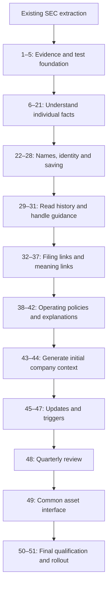

# Driver Workflow

> ⚠️ Living checklist: tick [x] when done · owner approves every other edit · fewest words · max 2 levels, no drop-downs.

**Now:** internalize the rulebook ([DRIVER_RULES.md](../DRIVER_RULES.md)).

**Goal:** turn unstructured text into Neo4j nodes/edges, stage by stage, until we trade company signals automatically. [Driver rules](../DRIVER_RULES_Categorized.md) apply. Updated 16 Nov 2026.

## Stages

- [ ] 1. **Drivers:** turn every source (SEC filings, transcripts, news, FiscalAI KPIs,  outside research) into Drivers and DriverUpdates.
- [ ] 2. **Explanations:** a workflow links each price move to the Driver updates behind it ([EXPLAINED_BY](../EXPLAINED_BY.md)).
- [ ] 3. **Context graph:** use the nodes, links and reasoning traces to know everything important about a company, with minimal noise.

## Company workflow

Build a company's context → keep it updated → trigger trade signals.

1. **Build the creator:** text → Drivers + DriverUpdates (4 fact types: `metric`, `guidance`, `surprise`, `action_event`).
   - [ ] Internalize the rulebook; fix what doesn't make sense ([DRIVER_RULES.md](../DRIVER_RULES.md)).
   - [ ] Rough pass, in order: fact? → which type? → about what? → fields → Driver name → check.
   - [ ] Try it on one small fixed set (transcript, 8-K, news; hand-checked); keep what works, change the rest, repeat.
   - [ ] Later: fix the interface ([shared creator](SharedCreator.md)) and sort every rule in order, until any asset runs through unchanged.
2. **Company context:** run the creator on each company's history.
   - [ ] Do 1 company, then 2, then 10, logging each run, until automatic.
   - [ ] Check each context for gaps with [Perplexity Finance](https://www.perplexity.ai/hub/solutions/finance) (Benzinga, Quartr …; [notes](../perplexity.md)). Tier data access unpublished: try individual Pro ($20) first; Enterprise ($40) adds data privacy.
3. **Update + trigger** (proposed: the [Decider](DeciderExtraction.md)): does a new report, news story or call update an existing Driver? If yes, send it through fact creation. Is the change worth evaluating as a trade?
4. **Quarterly review:** at each quarterly report, look deeper for new Drivers, missing updates and changes; feed them into the same history.

Steps 2–4 use the creator from step 1.

## Base + copies → [details](BaseAndCopies.md)

Several readers share one document: Claude loads it once, and copies reuse it. Tested: ~97% of input reused from cache · every reader must see the whole document (partial views broke cell references) · more readers = faster, not more complete · "success" can hide a safety stop, so check coverage · automatic scores overstated accuracy, so grade against an independent answer key.

## Shared creator → [details](SharedCreator.md)

Idea, not vetted: one shared creator, a single interface every caller uses to turn a document into checked Driver updates, so creation rules never split into versions.

## Ideas to test

- Big filings (10-K, 10-Q) → [base + copies](BaseAndCopies.md) (Claude); news, 8-Ks, transcripts → [Decider](DeciderExtraction.md).

## Confirmed decisions

- Driver names: always Sonnet 5.5 (high/xhigh/max); the system's integrity depends on it.
- Workers: [Decider](DeciderExtraction.md) first → small generic code → Sonnet 5.5 only where the Decider fails.

## Preliminary implementation order

### Top 10 build-and-test steps

Build these core components in this order. They cover the main system; **“90% of the design” has not been measured.** The full plan below still applies.

| Order | Main component | What belongs inside |
|---|---|---|
| **1** | **Keep the complete source** | Original text, tables, necessary context, exact evidence locations, version and publication time. Start with existing SEC extraction. |
| **2** | **Find the facts** | Find distinct supported claims, including numbers, qualitative facts and actions. Account for missed, held and rejected claims. |
| **3** | **Fill in each fact’s details** | Type, subject company, business part, measurement qualifiers, period, conditions, state, values, units and stated comparisons. Identify required companion facts and source-stated cause links. |
| **4** | **Propose Driver names** | Name each reusable meaning from its evidence, before showing the reader existing names. |
| **5** | **Match and independently check names** | Search the whole catalog; check reuse, new names, related types and duplicates. Keep uncertain meanings separate. |
| **6** | **Build reliable history reads** | Read raw facts, current facts and facts available at a past time. Compare only comparable facts; calculate permitted comparisons when reading. Supply earlier guidance only where the rules allow it. |
| **7** | **Check and save safely** | Complete dependent checks; save facts and required links together. Preserve permanent meanings, conflicting evidence and history; make unchanged reruns harmless. |
| **8** | **Explain price moves** | Set research limits, verify prices, judge supported explanations and research missing evidence through the same fact-creation steps. Keep later explanations out of earlier trading decisions. |
| **9** | **Build initial company context** | Agree company/source coverage and history limits. Process history oldest first using the shared steps, fill newly discovered metric histories, assemble the company picture and check gaps. |
| **10** | **Keep context updated and trigger work** | Handle new, edited and late sources; discover new Drivers; run quarterly reviews; evaluate information and price triggers. Valid facts never depend on a price move or trade signal. |

**In every step:** check correctness against independent answers; measure missed facts, refusals, cost and time. Choose the implementation through experiments, within the confirmed decisions above. These are components, not ten mandatory AI calls.

**Order and scope:**

- History reads must work before saving facts that depend on earlier guidance (3.7, 3.35). The detailed plan below builds a basic writer first, then adds history-dependent guidance; those cases wait until the reads and their checks work.
- Price explanations come before completing company context; initial context and later updates use the same process (8.16).
- Resolve open choices affecting permanent records before creating those records. Features outside these ten components remain in the full plan; they are not all simple later attachments.

### Detailed implementation steps

**Status:** practical to start implementing and testing; completing it reliably still requires resolving the marked decisions and proving each step works. This is a build-and-test sequence, not new rule authority or proof that the design is fully settled.

All **231 numbered rules**, plus Part A1 and the company workflow, are mapped below. Rule numbers refer to [DRIVER_RULES_Categorized.md](../DRIVER_RULES_Categorized.md); use the original when in doubt and ask the owner about unresolved rules.

**★ means an unresolved design decision must be settled at that step.** Those features remain included; an ordering cannot supply their missing definitions. See the [open-points review](../DRIVER_RULES_Discrepancies.md).

The existing [extraction units](https://app.notion.com/p/416a0a3f3106818cb2e9c7a0341cfeb9) and [readback](https://app.notion.com/p/416a0a3f3106813bae2ad0b1470b3cfb) are the SEC starting point.

These boxes describe **implementation order**, not separate services or mandatory AI calls. At every mini-step, test correctness, missed facts, cost and time before choosing its implementation. Confirmed decisions above still apply. Decider-first means choosing the model per task during development, not asking another model to overturn a valid refusal at runtime.

**1–5. Establish dependable input and testing.**

| Step | Implement and test | Rules |
|---|---|---|
| **1** | Create independently checked examples and expected answers. Reserve unseen cases. Track wrong answers, misses and refusals separately. | 2.44; 8.4, 8.6–8.7, 8.13, 8.17–8.18 |
| **2** | Inspect existing code and native library functions. Establish which decisions require meaning and which operations are mechanical. | 8.1, 8.3; project reuse requirements |
| **3 ★** | Establish source identity, original version, publication time, permitted source kind and required document ownership. Settle the intended use of 8-K item categories. | 1.4, 1.17; 8.8–8.9; 9.4–9.5 |
| **4** | Connect readable content to exact original passages/cells. Preserve headings, notes, speakers, images and complete filing context. | 1.11, 1.24; 8.10 |
| **5 ★** | Account for every assigned item. Distinguish no fact, incomplete reading, rejection and technical failure; implement permitted retry conditions. Settle any outcome simplification. | 8.12, 8.14–8.15; P6 |

**6–21. Understand facts before assigning permanent names.**

These steps produce **proposals**. They do not yet authorize saving.

| Step | Implement and test | Rules |
|---|---|---|
| **6** | Find eligible facts and separate distinct claims. Preserve multiple facts per sentence, table row or passage; exclude unsupported promotion and bare mentions. | 2.33; 8.10 |
| **7** | Establish who stated or confirmed each claim and whose fact it is. Distinguish the fact’s subject from the document owner and affected stock. | 1.26; 3.9 |
| **8 ★** | Determine fact type and its boundaries. Settle outside forecasts and forecasts of another party’s decision before accepting those cases. | 1.5–1.10, 1.22–1.23; 2.27–2.31; 7.7; 9.11; 10.5 |
| **9** | Separate the reusable cause, the company part being measured and the measurement version. | 2.12–2.14, 2.17; 3.13–3.15 |
| **10** | Review filing breakdown axes and prepare the company’s permitted, source-time slice choices. Preserve unknown axes and log exclusions. | 3.16–3.17, 3.19, 3.21 |
| **11** | Select or create exact slice values, including several simultaneous parts and genuinely whole-company facts. | 3.18, 3.20, 3.22–3.23 |
| **12** | Preserve measurement qualifiers and meaning-changing wording without merging synonyms. | 3.24–3.27 |
| **13 ★** | Identify source-stated quantities and their shapes: point, range, floor, ceiling or numberless. Settle table-dash interpretation. | 1.13; 3.48; 10.4 |
| **14** | Establish each amount’s unit, currency, scale and growth basis from evidence. | 3.28–3.33, 3.54; 9.1 |
| **15** | Resolve signed meaning, reverse bounds where necessary and perform exact rescaling without rounding. | 3.34; 3.29 |
| **16** | Distinguish a level, change, forecast revision and comparison. Select only the permitted main comparison. | 3.49–3.52; 4.6 |
| **17** | Resolve financial periods, fiscal calendars, exact dates, vague horizons and earnings-filing pairing. Source dates must outrank legacy defaults. | 3.36–3.47 |
| **18** | Assign metric and action states using the completed meaning, signed amounts and source wording. | 3.5–3.6, 3.8 |
| **19 ★** | Complete guidance-specific fields. Settle unconfirmed guidance, metric text values and action conditions before admitting those extensions. | 4.7–4.9; 9.2, 9.8 |
| **20** | Recognize source-stated surprises and propose their required result/forecast companion facts. Determine beat, miss, in-line or unknown. | 4.1–4.3, 4.10–4.17 |
| **21** | Propose source-stated cause and offset links between facts, with their own exact evidence. | 3.53 |

**22–31. Give facts stable identities, save safely and read them correctly.**

| Step | Implement and test | Rules |
|---|---|---|
| **22** | Generate source-grounded Driver names: specificity, wording, denominators, exclusions, suffixes and admission rules. Keep existing Driver names out of this discovery step. | 2.3, 2.5–2.11, 2.15–2.16, 2.18–2.19, 2.21–2.25 |
| **23** | Search the whole current catalog, including incomplete families. Test wording variants, competing matches and reuse of unchanged decisions. | 2.4, 2.36, 2.41–2.43, 2.45–2.46 |
| **24** | Qualify the independent identity checker against real positives and deliberately wrong proposals. Require evidence from both sides. | 1.12, 1.16; 2.40; 8.2, 8.5 |
| **25** | Implement reuse versus creation, family admission and qualitative duplicate checks. Check companion facts against the resolved Driver choices. | 1.1–1.2, 1.18; 2.20, 2.26, 2.32, 2.34–2.35, 2.37–2.39, 2.47 |
| **26 ★** | Finalize permanent records, frozen birth evidence and fact IDs. Resolve outstanding stored-field choices, financial classification and wrong-name/type handling before freezing the write contract. | 2.1–2.2; 3.1–3.4, 3.10; 9.6; 10.2; P1–P2 |
| **27** | Combine compatible pieces, preserve conflicting values and protect distinct occurrences. Test all input orders and unchanged replays. | 5.2–5.4, 5.9 |
| **28** | Save facts and required links together. Test stale approvals, concurrent arrivals, amendments, blank filling and permanent-field protection. | 1.15; 5.1, 5.5, 5.7–5.8; 6.20–6.21 |
| **29** | Build shared raw, current, history and point-in-time reads. Apply exact grouping, source priority, unknown-unit isolation and future-information exclusion. | 1.14–1.25 where applicable; 3.35; 7.1–7.6, 7.11 |
| **30** | Calculate permitted forecast movements and comparisons when reading, without writing calculated results back. | 4.4–4.5; 7.8 |
| **31 ★** | Add cases requiring earlier guidance: numberless reaffirmations, inherited series units and withdrawal expansion. Settle withdrawal rules first. | 3.7, 3.35; 4.18–4.21 |

**32–37. Complete the additional graph relationships and their reading rules.**

| Step | Implement and test | Rules |
|---|---|---|
| **32** | Match metric facts to official filing line items, with independent meaning checks and exact mechanical refusal checks. | 3.11; 6.1–6.8 |
| **33** | Attach filing breakdown members only when one complete reporting context proves the exact combination. | 6.9–6.10 |
| **34 ★** | Add eligible tagged numeric facts only after their metric Driver and company-specific line-item link exist. Resolve text/tagged conflicts, upgrades and record requirements first. | 6.11–6.12; **Part A1** |
| **35 ★** | Implement `SAME_AS` after agreeing its creation and reversal process. Preserve separate stored identities. | 1.19; 5.6; 9.9 |
| **36 ★** | Implement declared renames, complete rename records, company ownership, dates, disabling rules and structural checks. | 6.13–6.19; 9.10 |
| **37 ★** | Finish reconciled histories, permitted label grouping and cross-company views. Resolve cross-company slice matching, unknown-axis views and historical industry membership. | 7.9–7.11; 9.3 |

**38–42. Build the operating and explanation capabilities that company workflows will call.**

| Step | Implement and test | Rules |
|---|---|---|
| **38 ★** | Establish company eligibility, source coverage, history limits, research budgets and service targets using measured capacity. | 1.20–1.21; 10.1, 10.3 |
| **39** | Verify publication availability, price inputs and trading windows before using returns. Resolve or exclude unverified measurements. | A2.7; **[EXPLAINED_BY §8](../EXPLAINED_BY.md#8-return-measurements--open-checks-for-the-next-bot)** |
| **40** | Produce supported daily explanations: affected company, reason, direction, strength and confidence. Grade explanations as a set. | 3.12; 9.7; A2.1, A2.3–A2.4, A2.6, A2.8 |
| **41** | Save and read explanations correctly: latest completed result, explicit withdrawal, delayed-write protection and decision-time availability. | A2.2, A2.5 |
| **42** | Retrieve missing original research evidence and feed it through the same source/fact process. Preserve its actual publication time. | 1.3–1.4, 1.17; 9.5; research-source rules |

**43–51. Build the distinct company workflows, then finish integration.**

| Step | Implement and test | Governing area |
|---|---|---|
| **43** | **Initial context generation:** process the agreed historical sources oldest first. Fill newly discovered metric histories through the same creator. | 8.16; company workflow step 2 |
| **44** | Check initial company context for missing information; research gaps within limits and add supported facts/explanations. Test one company, then two, then ten. | Company workflow step 2; shared reads and coverage rules |
| **45** | **Information updates:** handle new publications, edits and late arrivals. Update known Drivers while retaining discovery of new ones. | 8.14–8.16; [News rules](../NewsMultipleSymbols.md); company workflow step 3 |
| **46 ★** | Compare the updated context with its prior state and test what warrants **trade evaluation**. This decision must not suppress otherwise valid facts. | 1.25, 2.33; company workflow step 3 |
| **47 ★** | **Price-triggered research:** choose validated measurements and significance settings; reuse saved evidence, investigate gaps and produce supported explanations. | 8.16; 10.1; A2 |
| **48** | **Quarterly review:** conduct the broader search for new Drivers, missed updates and changed circumstances through the same creator and views. | Company workflow step 4 |
| **49** | Finalize the **common asset interface** for reports, transcripts, news and other admitted inputs. Keep one set of creation rules and outcomes. | 2.34; 8.9–8.10; 9.5 |
| **50** | Measure batching, caching and other optimizations; freeze the actual configuration; run fresh, independent tests of the complete system and each source channel. | 8.12–8.13, 8.17–8.18; 9.5 |
| **51** | Activate in measured stages. Move consumers to shared reads; retire old Guidance only under the preservation and history rules. | 8.11, 8.16; 10.3 |

**Key dependencies**

- Facts before names; names before identity approval; approval before saving.
- Shared reads before history-dependent guidance and company workflows.
- Approved metric identities before tagged-data facts.
- Verified returns before price-based triggers and explanations.
- Initial context, updates and quarterly review remain distinct callers of the same capabilities.
- The common interface is finished last, but sits at the entrance when the system runs.

Tests belong inside every step. Step 50 checks the completed combination; it is not the first accuracy check.
