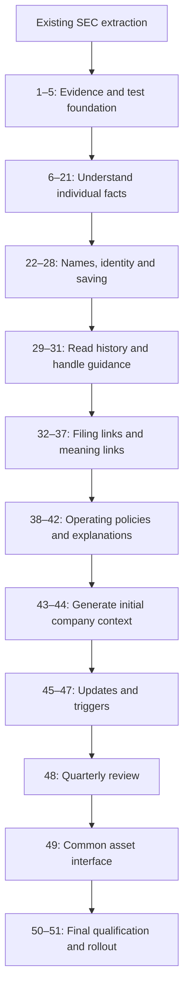

# Driver Workflow

> ⚠️ Living checklist: tick [x] when done · owner approves every other edit · fewest words · max 2 levels, no drop-downs.

**Now:** internalize the rulebook ([DRIVER_RULES.md](../DRIVER_RULES.md)).

**Goal:** turn unstructured text into Neo4j nodes/edges, stage by stage, until we trade company signals automatically.

## Stages

- [ ] 1. **Drivers:** turn every source (SEC filings, transcripts, news, FiscalAI KPIs,  outside research) into Drivers and DriverUpdates.
- [ ] 2. **Explanations:** a workflow links each price move to the Driver updates behind it ([EXPLAINED_BY](../EXPLAINED_BY.md)).
- [ ] 3. **Context graph:** use the nodes, links and reasoning traces to know everything important about a company, with minimal noise.

## Company workflow

Build a company's context → keep it updated → trigger trade signals.

1. **Build the creator:** text → Drivers + DriverUpdates (`metric`, `guidance`, `surprise`, `action_event`, `expectation`).
   - [ ] Internalize the rulebook; fix what doesn't make sense ([DRIVER_RULES.md](../DRIVER_RULES.md)).
   - [ ] Rough pass, in order: fact? → which type? → about what? → fields → Driver name → check.
   - [ ] Try it on one small fixed set (transcript, 8-K, news; hand-checked); keep what works, change the rest, repeat.
   - [ ] Later: fix the interface ([shared creator](SharedCreator.md)) and sort every rule in order, until any asset runs through unchanged.
2. **Company context:** run the creator on each company's history.
   - [ ] Do 1 company, then 2, then 10, logging each run, until automatic.
   - [ ] Check each context for gaps with [Perplexity Finance](https://www.perplexity.ai/hub/solutions/finance) (Benzinga, Quartr …; [notes](../perplexity.md)). Tier data access unpublished: try individual Pro ($20) first; Enterprise ($40) adds data privacy.
3. **Update + trigger** (proposed: the [Decider](DeciderExtraction.md)): does a new report, news story or call update an existing Driver? If yes, send it through fact creation. Is the change worth evaluating as a trade?
4. **Quarterly review:** at each quarterly report, look deeper for new Drivers, missing updates and changes; feed them into the same history.

Steps 2–4 use the creator from step 1.

## Base + copies → [details](BaseAndCopies.md)

Several readers share one document: Claude loads it once, and copies reuse it. Tested: ~97% of input reused from cache · every reader must see the whole document (partial views broke cell references) · more readers = faster, not more complete · "success" can hide a safety stop, so check coverage · automatic scores overstated accuracy, so grade against an independent answer key.

## Shared creator → [details](SharedCreator.md)

Idea, not vetted: one shared creator, a single interface every caller uses to turn a document into checked Driver updates, so creation rules never split into versions.

## Ideas to test

- Big filings (10-K, 10-Q) → [base + copies](BaseAndCopies.md) (Claude); news, 8-Ks, transcripts → [Decider](DeciderExtraction.md).

## Confirmed decisions

- For each AI task, including Driver naming, use the cheapest model that passes its tests (8.13, 8.17).
- Test the [Decider](DeciderExtraction.md) first for worker tasks. Use small, generic code for mechanical steps (8.4).

## Preliminary implementation order

### Top 10 build-and-test steps

Build these core components in this order. They cover the main system; **“90% of the design” has not been measured.** The full plan below still applies.

| Order | Main component | What belongs inside |
|---|---|---|
| **1** | **Keep the complete source** | Original text, tables, necessary context, exact evidence locations, version and publication time. Start with existing SEC extraction. |
| **2** | **Find the facts** | Find distinct supported claims, including numbers, qualitative facts and actions. Account for missed, held and rejected claims. |
| **3** | **Fill in each fact’s details** | Type, subject company, business part, measurement qualifiers, period, conditions, state, values, units and stated comparisons. Identify required companion facts and source-stated cause links. |
| **4** | **Propose Driver names** | Name each reusable meaning from its evidence, before showing the reader existing names. |
| **5** | **Match and independently check names** | Search the whole catalog; check reuse, new names, related types and duplicates. Keep uncertain meanings separate. |
| **6** | **Build reliable history reads** | Read raw facts, current facts and facts available at a past time. Compare only comparable facts; calculate permitted comparisons when reading. Supply earlier guidance only where the rules allow it. |
| **7** | **Check and save safely** | Complete dependent checks; save facts and required links together. Preserve permanent meanings, conflicting evidence and history; make unchanged reruns harmless. |
| **8** | **Explain price moves** | Set research limits, verify prices, judge supported explanations and research missing evidence through the same fact-creation steps. Keep later explanations out of earlier trading decisions. |
| **9** | **Build initial company context** | Agree company/source coverage and history limits. Process history oldest first using the shared steps, assemble the company picture and check gaps. |
| **10** | **Keep context updated and trigger work** | Handle new, edited and late sources; discover new Drivers; run quarterly reviews; evaluate information and price triggers. Valid facts never depend on a price move or trade signal. |

**In every step:** check correctness against independent answers; measure missed facts, refusals, cost and time. Choose the implementation through experiments, within the confirmed decisions above. These are components, not ten mandatory AI calls.

**Order and scope:**

- History reads must work before saving facts that depend on earlier guidance (3.7, 3.35). The detailed plan below builds a basic writer first, then adds history-dependent guidance; those cases wait until the reads and their checks work.
- Price explanations come before completing company context; initial context and later updates use the same process (8.16).
- Resolve open choices affecting permanent records before creating those records. Features outside these ten components remain in the full plan; they are not all simple later attachments.

### Detailed implementation steps

**Status:** practical to start implementing and testing; completing it reliably still requires resolving the marked decisions and proving each step works. This is a build-and-test sequence, not new rule authority or proof that the design is fully settled.

The [current rulebook](../DRIVER_RULES.md) governs. [ReasoningTasks.md](../ReasoningTasks.md) lists the AI judgments. [Workflow v2](DriverWorkflow_v2.md) sketches the wider paper-trading workflow. The [categorized original](../DRIVER_RULES_Categorized.md) preserves the earlier numbering.

**★ marks an open workflow design choice.** See [processing and service targets (P6, 10.3)](../DRIVER_RULES.md#s3--processing-timing--retries) and [price triggers and research limits (10.1)](../DRIVER_RULES.md#s5--price-move-explanations).

The [handoff](../../../../../driver/Prompts/design_discussion_handoff.txt) lists the implementation and data checks for the reviewed issues.

The existing [extraction units](https://app.notion.com/p/416a0a3f3106818cb2e9c7a0341cfeb9) and [readback](https://app.notion.com/p/416a0a3f3106813bae2ad0b1470b3cfb) are the SEC starting point.

These boxes describe **implementation order**, not separate services or mandatory AI calls. At every mini-step, test correctness, missed facts, cost and time before choosing its implementation. Confirmed decisions above still apply. Decider-first means choosing the model per task during development, not asking another model to overturn a valid refusal at runtime.

**1–5. Establish dependable input and testing.**

| Step | Implement and test | Rules |
|---|---|---|
| **1** | Create independently checked examples and expected answers. Reserve unseen cases. Track wrong answers, misses and refusals separately. | 2.44; 8.4, 8.7, 8.13, 8.17–8.18 |
| **2** | Inspect existing code and native library functions. Establish which decisions require meaning and which operations are mechanical. | 8.1, 8.3; project reuse requirements |
| **3** | Record source kind, ID, version, public time when known and required owner. Apply News admission and ticker-link rules. Keep 8-K item numbers as filing information and cite the supporting passage or exhibit. | 1.4, 1.17, 3.9; 8.8–8.9; 9.4–9.5 |
| **4** | Preserve full source order, headings, notes, speakers and images. Code verifies locations and copies the exact cited passages or cells from that version. | 1.11, 1.17, 1.24; 8.8, 8.10 |
| **5 ★** | Track five outcomes per source/version, assigned unit, requested type and, if split, company. Skip finished work except permitted rereads. Retry only as allowed. Link each call’s step, model ID and start time with zone to its items, write results and fact IDs when available. Revisit P6 at writer redesign. | 8.12, 8.14–8.16; P6 |

**6–21. Understand facts before assigning permanent names.**

Use common instructions plus any of the five fact-type sections to propose facts and fields. Filing setup (10), date resolution (17) and the later checks are workflow tasks.

| Step | Implement and test | Rules |
|---|---|---|
| **6** | Find eligible facts and separate distinct claims. Preserve multiple facts per sentence, table row or passage; exclude unsupported promotion and bare mentions. | 2.33; 8.10 |
| **7** | Establish who stated or confirmed each claim and whose fact it is. Distinguish the fact’s subject from the document owner and affected stock. | 1.26; 3.9 |
| **8** | Classify each claim. An outside forecast is an expectation. A company predicting another party’s action gives an action forecast. | 1.5–1.10, 1.22–1.23; 2.27–2.31; 7.7; 9.11; 10.5 |
| **9** | Separate the reusable cause, the company part being measured and the measurement version. | 2.12–2.14, 2.17; 3.13–3.15 |
| **10** | Classify filing breakdown axes offline from their members. Offer the company's slice values available at the source’s public time. Preserve unknown axes and log segment-list exclusions. | 3.16–3.17, 3.19, 3.21 |
| **11** | Select or create exact slice values, including several simultaneous parts and genuinely whole-company facts. | 3.18, 3.20, 3.22–3.23 |
| **12** | Preserve measurement qualifiers and meaning-changing wording without merging synonyms. | 3.24–3.27 |
| **13** | Identify points, ranges, floors, ceilings and numberless claims. Read a dash as zero only when the source explicitly defines it as zero for that cell. | 1.13; 3.48; 10.4 |
| **14** | Establish each amount’s unit, currency, scale and growth basis from evidence. | 3.28–3.33, 3.54; 9.1 |
| **15** | Resolve signed meaning, reverse bounds where necessary and perform exact rescaling without rounding. | 3.34; 3.29 |
| **16** | Distinguish a level, change, forecast revision and comparison. Select only the permitted main comparison. | 3.49–3.52; 4.6 |
| **17** | Resolve fiscal periods and dates using matching filing evidence before cached dates. For an earnings 8-K held for an unclear quarter, reopen only when a 10-Q or 10-K proves the company and quarter. | 3.36–3.47 |
| **18** | Assign metric and action states using the completed meaning, signed amounts and source wording. | 3.5–3.6, 3.8 |
| **19** | Record guidance confirmation, source wording for numberless measures and source-stated conditions on guidance and actions. | 4.7–4.9; 9.2, 9.8 |
| **20** | Find each stated surprise and its matching result or confirmed company forecast, even on a surprise-only read. Reread the whole event if the companion is missing. Determine beat, miss, in-line or unknown. | 4.1–4.3, 4.10–4.17 |
| **21** | Propose source-stated cause and offset links between facts, with their own exact evidence. | 3.53 |

**22–31. Give facts stable identities, save safely and read them correctly.**

| Step | Implement and test | Rules |
|---|---|---|
| **22** | AI proposes a reusable name from source wording before seeing saved names. Apply specificity, wording, denominator, exclusion and suffix rules. | 2.3, 2.5–2.11, 2.15–2.16, 2.18–2.19, 2.21–2.25 |
| **23** | Search same-type definitions across companies by words, meaning and name variants. Apply 2.41 to ties. Before creation, check remaining definitions, name availability across types and incomplete families. Per unchanged input, check at most one shortlist name and one different full-search name. | 2.4, 2.36, 2.41–2.43, 2.45–2.47 |
| **24** | Independently check each fact’s proposed Driver against both sides’ evidence. Hide past verdicts, similarity scores, synonym links, tie-break counts and proposer reasoning. Reuse unchanged decisions. Test correct and deliberately wrong proposals. | 1.12, 1.16; 2.40, 2.46; 8.2, 8.5 |
| **25** | Reuse a proven match. Creating a Driver requires its first accepted fact and an independent check for differently worded duplicates. On family admission, check the underlying measure against every member. Require an accepted same-event companion for a surprise. | 1.1–1.2, 1.18; 2.20, 2.26, 2.32, 2.34–2.35, 2.37–2.39, 2.47; 4.14 |
| **26** | Freeze Driver name, type, first fact ID and defining evidence. Build fact IDs from source, Driver and scope. Omit financial classification. If a saved name or type contradicts its evidence, refuse reuse and log the name and evidence. Preserve earlier facts. | 2.1–2.2; 3.1–3.4, 3.10; 9.6; 10.2 |
| **27** | Combine compatible details of one claim within one source version, keeping each citation in the existing read and save steps. Preserve conflicts and distinct occurrences. Test input order and repeat runs. | 5.2–5.4, 5.9 |
| **28** | Code verifies numbers, units, dates, IDs and links. Cover same-type Drivers added during search before creation. Save facts and required links together only while approvals hold. Test concurrent writes, supported blank filling, frozen fields and later publications as separate facts. | 1.15; 3.9–3.10, 3.53; 5.1, 5.5, 5.7–5.8; 6.20 |
| **29** | Provide shared raw, current, history and point-in-time views. Use exact groups, source priority and separate unknown units. Keep conflicts visible and action predictions separate from reported stages. Past views require proof the cited version was public before the cutoff. | 1.14–1.25 where applicable; 3.35; 7.1–7.6, 7.11; 10.5 |
| **30** | Calculate permitted guidance movements and comparisons on read. Match outside forecast updates by forecaster, target and proven decision order. Preserve conditional alternatives. Stored history alone cannot establish an outside revision. | 4.4–4.5, 4.17; 7.1, 7.8; 9.2, 9.11 |
| **31** | A numberless guidance reaffirmation inherits its unit only from one matching prior forecast with the same confirmation. Save each company guidance withdrawal once as an action. On read, AI judges coverage. Apply withdrawals, exceptions and replacements in effective order. | 2.46; 3.7, 3.35; 4.18–4.21; 8.1 |

**32–37. Complete the additional graph relationships and their reading rules.**

| Step | Implement and test | Rules |
|---|---|---|
| **32** | Try optional filing links once per accepted eligible fact. AI selects the exact base-metric line and code checks it. Eligible guidance and surprises inherit it on read. For 10-Q/10-K filings and their amendments, only linking waits for their tags or retry limit. | 3.11; 6.1–6.8 |
| **33** | For any of the five fact types, attach filing breakdown members only when one complete reporting context proves the exact combination. | 3.11; 6.9–6.10 |
| **34** | Keep tagged numeric facts off until conflict, precision, evidence and subtotal tests pass. Once enabled, a new approved link between a company’s filing line and an existing metric triggers processing of all its eligible filings. | 6.11–6.12; **Part A1** |
| **35** | Only the fact checker flags possible synonyms. Independently check eligible pairs using names, types and defining evidence. Placement never waits. Log clear contradictions in joined definitions. Test blocked groups and owner switch-off/restoration before enabling links. | 1.19, 5.6, 6.18, 7.1, 9.9 |
| **36** | Flag explicit renames during filing reads. Independently verify both names on the company’s accepted facts and its declaration of unchanged contents and method. Save one note per approved rename with its source’s proven public time. Apply the switch-off and uniqueness rules. | 6.13–6.18; 9.10 |
| **37** | Join declared renames on request. Group proven label variants within one company. Keep unknown breakdowns under their saved kind. Industry comparisons use today’s official groups for all years. | 7.9–7.11; 9.3 |

**38–42. Build the operating and explanation capabilities that company workflows will call.**

| Step | Implement and test | Rules |
|---|---|---|
| **38 ★** | Check official company eligibility and refresh the catalog under 1.21. Set coverage, history limits and research budgets from one company’s measured cost and time. Set schedules, alerts and service targets. | 1.20–1.21, 8.16; 10.1, 10.3 |
| **39** | Verify publication availability, price inputs and trading windows before using returns. Resolve or exclude unverified measurements. | A2.7; **[EXPLAINED_BY §8](../EXPLAINED_BY.md#8-return-measurements--open-checks-for-the-next-bot)** |
| **40** | AI judges which facts, if any, contributed to each affected company’s daily move. Give the reason, direction, strength if known and confidence. Grade explanations as a set. | 3.12; 9.7; A2.1, A2.3–A2.4, A2.6, A2.8 |
| **41** | Code validates daily judgments and keeps the latest completed result per company, day, fact and producer. Honor explicit withdrawals, guard against delayed writes, and apply the [live and replay cutoffs](../DRIVER_LearnerPredictor.md#input-cutoff). | A2.1–A2.2, A2.5 |
| **42** | Retrieve missing original research evidence, including selected articles without tracked tickers. Use the same source/fact process and preserve the version’s public time when known. | 1.3–1.4, 1.17; 9.5; research-source rules |

**43–51. Build the distinct company workflows, then finish integration.**

| Step | Implement and test | Governing area |
|---|---|---|
| **43** | Read initial company history oldest first. Afterward, the first accepted fact for a metric new to that company starts one oldest-first search for that measure within coverage and the 12 months before the source’s proven public time. Unknown source public time or a look-back discovery starts no search. | 8.14, 8.16; company workflow step 2 |
| **44** | Check initial company context for missing information; research gaps within limits and add supported facts/explanations. Test one company, then two, then ten. | Company workflow step 2; shared reads and coverage rules |
| **45** | Process new, edited and late sources at their own public time when known. Keep the news quote and version reference after edits. Update known Drivers and discover new ones regardless of price movement. | 7.6, 8.14–8.16; [News rules](../NewsMultipleSymbols.md); company workflow step 3 |
| **46 ★** | Call at earnings releases or verified watchlist matches from other newly public versions. Seal one paper call per company/source version for live and separately per replay. Code supplies cutoff-safe input and verifies cited IDs were shown. Exact briefing contents remain open. | 1.25, 2.33; [Predictor and watchlist](../DRIVER_LearnerPredictor.md#predictor), [input cutoff](../DRIVER_LearnerPredictor.md#input-cutoff) |
| **46a** | Grade once from verified entry and end prices. Ungraded if either is unavailable or entry is at or after horizon end. Record the move skipped for no trade. Count graded calls by horizon and mode separately from explained company-days. Only live calls measure performance. | [Grading](../DRIVER_LearnerPredictor.md#grading) and [Driver histories](../DRIVER_LearnerPredictor.md#driver-histories) |
| **47 ★** | Research verified qualifying moves, even without news or a call. Reuse saved evidence first. Reconcile rule 10.1 and [explanation §7](../EXPLAINED_BY.md#7-remaining-decisions-and-implementation-work), which list settings as open, with the paper plan’s [absolute stock–SPY gap of at least 2.2 percentage points](../DRIVER_LearnerPredictor.md#qualifying-move). | 8.16; 10.1; A2 |
| **48** | **Quarterly review:** conduct the broader search for new Drivers, missed updates and changed circumstances through the same creator and views. | Company workflow step 4 |
| **48a** | Review each live call at horizon end, qualifying moves at the prescribed close, moves due at earnings preview, and every earnings event. Keep calls, results and reviews only in Neo4j. Link reviews to calls and route discoveries through the existing fact and explanation paths. | [Learner reviews](../DRIVER_LearnerPredictor.md#learner-reviews) |
| **49** | Finalize the **common asset interface** for reports, transcripts, news and other admitted inputs. Keep one set of creation rules and outcomes. | 2.34; 8.9–8.10; 9.5 |
| **50** | Measure batching and caching. Freeze the configuration and test the complete system and each source channel on fresh, independently graded cases. Catalog launch requires fewer than 1% materially wrong facts at 95% confidence. | 8.12–8.13, 8.17–8.18; 9.5 |
| **51** | Activate in measured stages and move consumers to shared reads. At old Guidance retirement, keep a restorable copy and choose whether to accept a measured gap or wait for fresh history. | 8.11, 8.16; 10.3 |

**Key dependencies**

- Facts before names; names before identity approval; approval before saving.
- Shared reads before history-dependent guidance and company workflows.
- Approved metric identities before tagged-data facts.
- Verified returns before price-based triggers and explanations.
- Initial context, updates and quarterly review remain distinct callers of the same capabilities.
- The common interface is finished last, but sits at the entrance when the system runs.

Tests belong inside every step. Step 50 checks the completed combination; it is not the first accuracy check.
