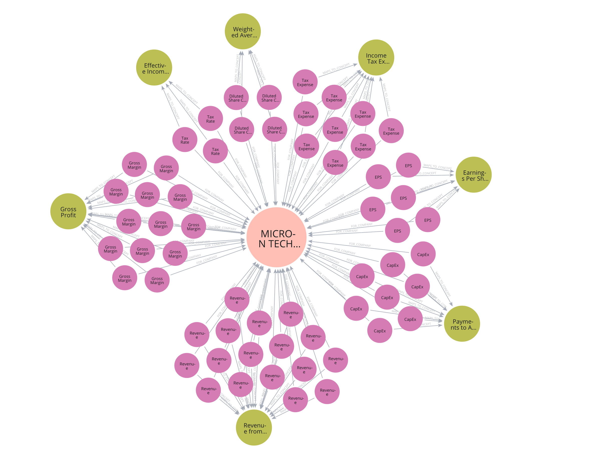
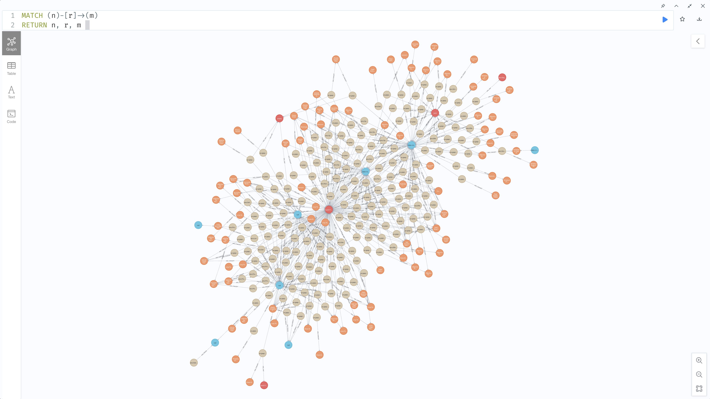

# EventTrader

EventTrader uses AI agents and a financial knowledge graph to research trading signals from SEC filings, news and earnings-call transcripts. It connects financial events with company fundamentals and subsequent market returns to help evaluate those signals.

## Micron Financial Knowledge Graph

*Historical prototype snapshot (May 2026): Micron company metrics linked to financial concepts.*

## Nodes & Relationships in Graph DB

